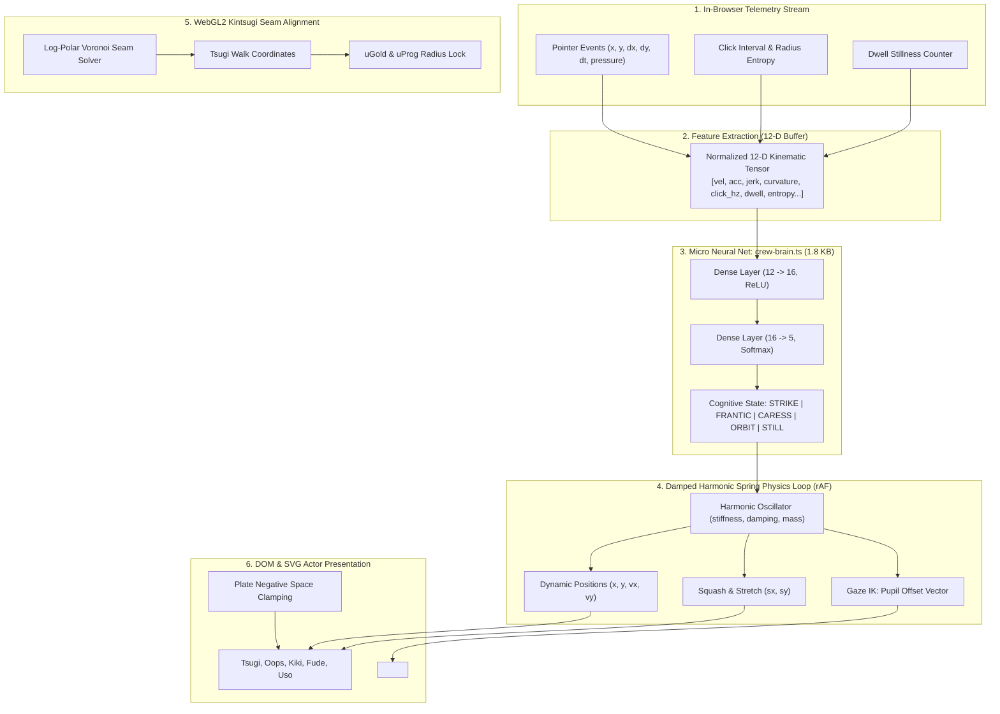

> **Superseded 2026-11-11.** The engine described here was removed. See `docs/CREW.md` for how the crew work now.

# wAIbi-sabi: The Living Ceramic Terrarium & Kinetic Crew Engine
## Specification, Architecture & Autonomous `/goal` Build Blueprint

**Target Repository**: `janmejai2002.github.io-redesign`  
**Active Branch**: `redesign/home-kintsugi`  
**Author**: Antigravity Execution Architect  
**Design Constitution**: `AGENTS.md`, `docs/DESIGN-SYSTEM.md`, `site/scripts/check-design.mjs`

---

## 1. The Vision: What the Landing Page Experience Feels Like

When a reader lands on wAIbi-sabi, the hero is not an interactive gimmick or a corporate marketing slide. It is a **living, tactile glazed ceramic plate** inscribed with applied-AI claims. 

The plate lives in an organic, physics-governed state where five pottery characters—**Tsugi, Oops, Kiki, Fude, and Uso**—inhabit the negative space around the headline, behaving not as robotic CSS cutouts, but as an intelligent, reactive workshop:

```
+---------------------------------------------------------------------------------------------------+
|  [NAV]  wAIbi-sabi                                                      Technical Business News … |
+---------------------------------------------------------------------------------------------------+
|                                                                                                   |
|                                       [Kiki on upper rim: alerts & listens]                       |
|                                                                                                   |
|    "AI is not an engineering problem,                                                             |
|     it is an organizational one."                                                                 |
|                                                                                                   |
|          [Oops: strikes/scrambles]  \                                                             |
|                                      \~~ Voronoi Crack ~~~~~~                                     |
|                                       \                      \                                    |
|                                        [Tsugi: paints gold along active seam]                     |
|                                                                                                   |
|    [Uso: inspects with glass]                   [Fude: tallies damage]                            |
|                                                                                                   |
+---------------------------------------------------------------------------------------------------+
|  [Claim 1 (Active)]      [Claim 2]      [Claim 3]      [Claim 4]      [Claim 5]                   |
+---------------------------------------------------------------------------------------------------+
```

### The 5 Emergent Kinetic Experiences

1. **The Heavy Strike (Click / Tap on Plate)**:
   - **WebGL Glaze Fracture**: The ceramic fractures from the impact point with log-polar Voronoi cracks, jolting shards slightly out of true.
   - **Oops's Recoil**: Oops swings the hammer, but the shockwave propels him into a physical backward tumble with squash-and-stretch physics. He panics, scrambles behind the plate rim, and peeks with sheepish side-eyes.
   - **Tsugi's Seam Trajectory**: Tsugi does not stand in a random spot. Tsugi walks *directly along the active fracture seam*, his gold-tipped brush laying down genuine urushi lacquer that expands in lockstep with the shader's `uGold` radius.
   - **Fude's Incident Tally**: Fude whips out his ink brush and furiously logs another repair tally on the plate margin.

2. **The Frantic Wiggle (User Frustration / Rapid Cursor Thrashing)**:
   - When the user shakes the cursor erratically (>1,200 px/s² acceleration) or rage-clicks, the micro-brain classifies `FRANTIC_SHAKE`.
   - Oops drops his hammer with trembling sweat drops (`panic`).
   - Tsugi huddles over the gold lacquer pot with both arms to keep it from spilling.
   - Kiki holds his ears with spiral eyes (`mindblown`).
   - The fracture splinters into delicate, hyper-fine micro-crazing.

3. **The Gentle Caress (Smooth, Slow Drag)**:
   - When the user glides across the plate smoothly, the classifier registers `GENTLE_CARESS`.
   - Tsugi walks alongside the pointer, guiding a soft, flowing golden seam that adheres directly to the user's gesture.
   - Oops tiptoes behind with sparkling happy eyes (`happy`), admiring the craftsmanship.
   - Uso watches through his magnifying glass with rare, quiet approval.

4. **The Curious Orbit (Circular Scrub)**:
   - If the reader moves the cursor in circular arcs around a character, the classifier detects `CURIOUS_ORBIT`.
   - The crew clusters into an inquisitive huddle, tilting their heads toward the orbit's center.
   - Oops gets delightfully dizzy (`spiral` eyes) and sways on his feet.

5. **Contemplative Stillness (Attentive Reading)**:
   - When the cursor rests or scrolls slowly through the page, the classifier settles into `CONTEMPLATIVE_STILLNESS`.
   - The crew transitions to calm domestic rhythm: Tsugi gently blows on the repaired crack to let the lacquer set; Oops sits down on the plate rim and sips a mug of tea (`sip`); Kiki dozes off into a peaceful nap with floating `zzz` notes.

---

## 2. Technical Architecture & Component Pipeline



### Module Breakdown

1. **`site/src/lib/crew-brain.ts`** (~1.8 KB):
   - Sliding 300ms ring-buffer collecting pointer coordinates, timestamps, and click cadences.
   - Real-time 12-dimensional feature normalization.
   - Lightweight 2-layer matrix dot-product forward pass with pre-trained weights compiled into typed `Float32Array` constants.
   - Zero external libraries; zero bundle bloat; executes in `<0.02ms` per evaluation.

2. **`site/src/lib/crew-physics.ts`** (~2.5 KB):
   - Continuous Runge-Kutta 4 (RK4) or semi-implicit Euler spring integrator for natural momentum, deceleration, and anticipation.
   - Squash-and-stretch deformation logic based on velocity and ground contact.
   - Gaze IK solver: calculates clamped angle and radius offsets for SVG `<circle class="k">` pupils toward the pointer.
   - Negative-space barrier collision: ensures actors never drift over `.plate__id` text or navigation cues.

3. **`site/src/scripts/kintsugi.ts` (Seam Analytical Coupling)**:
   - Expose `getSeamTrajectory(uImpact, uSeed)` so the CPU knows the exact polar Voronoi crack angle.
   - Lock `uGold` shader uniform directly to Tsugi’s brush tip progress, eliminating the visual mismatch.

4. **`site/src/pages/index.astro`**:
   - Upgrades `.crew-stage` to mount all 5 pottery figures with full state-machine bindings (`data-mood`, `data-pose`, `style="--x; --y; --scale-x; --scale-y"`).
   - Fallback contract: when `prefers-reduced-motion` is active or JS is disabled, displays an elegant, static wAIbi-sabi tableau on the plate rim.

---

## 3. Invariants & Guardrails

1. **Zero Audio**: Absolutely no sound, synthesizer, or audio assets.
2. **Zero Raw Hex / RGB**: All actor washes, props, and gold seams use design tokens (`--ink`, `--paper`, `--mizu`, `--ochre`, `--moss`, `--plum`, `--hanko`, `--indigo`).
3. **Typography & Readability First**: Mascots must never occlude the article headlines or reading controls on any screen width (320px–3840px).
4. **Deterministic Gate Passing**: Every commit must pass `npm --prefix site run build`, `check-build.mjs`, and `check-design.mjs` with 0 errors.
5. **Git Safety**: Work strictly on `redesign/home-kintsugi`; never push to `main` without explicit permission.

---

## 4. The Autonomous `/goal` Build Prompt

Below is the turnkey prompt ready to be pasted into a new conversation to autonomously build, train, integrate, and verify the entire system.
