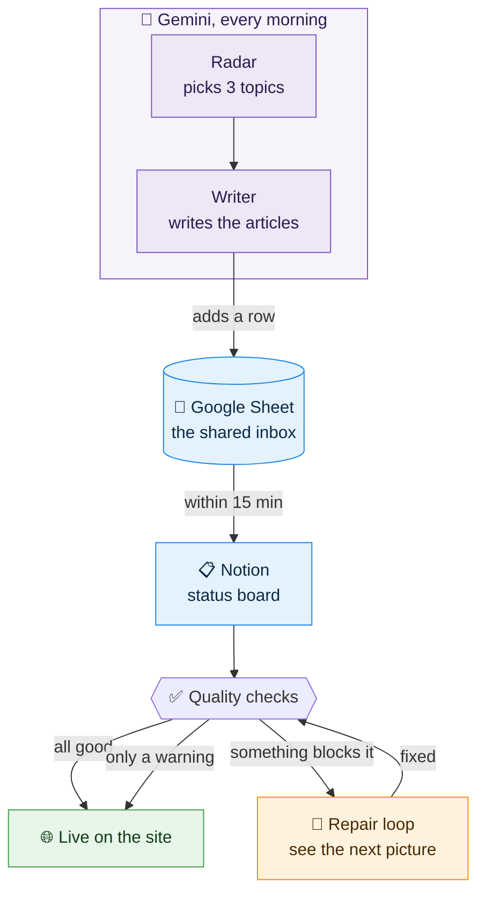
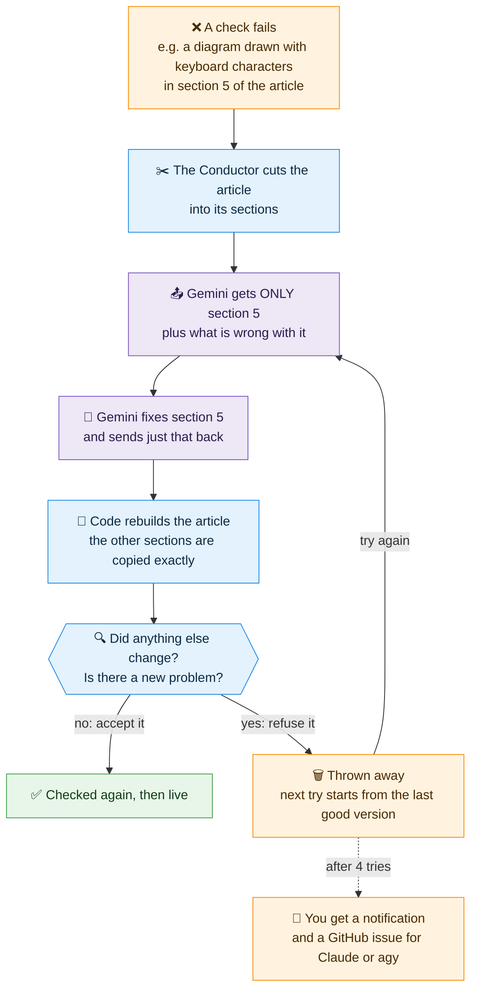

# How wAIbi-sabi Works — the plain-English version

Last checked against the real system: 11 November 2026, after the repair-loop upgrade.
If you only read one document about this blog, read this one.

---

## The one-paragraph version

Five AI assistants, all run by Gemini on Google's computers, wake up at set times each day. They research, write, and drop their work into **one Google Sheet**. A set of robots on GitHub copies anything new from that sheet into **Notion**, turns it into a web page, runs a long list of quality checks, and if everything passes, puts it live on **janmejai2002.github.io**. When an article fails a check, a sixth assistant repairs exactly the part that failed, and code checks the repair before it is used. Notion is where you see what's happening. Nothing needs your laptop to be on.

## The picture

How an article gets from an idea to the live site. Purple is Gemini, blue is where things are stored, green is live, orange is a problem being handled.

## The cast

| Who | Where it lives | What it does | When (IST) |
|---|---|---|---|
| **Case Studies writer** | Gemini (Scheduled) | Picks a company's real AI rollout and writes a 4-part autopsy | 1:00 AM |
| **Radar** | Gemini (Scheduled) | Finds 3 fresh topics (Technical, Business, Basics) with a research brief each | 3:35 AM |
| **Article Writer** | Gemini (Scheduled) | Writes full articles for the 3 radar topics | 4:15 AM |
| **News curator** | Gemini (Scheduled) | Picks 5 business stories for MBA interview prep | 6:00 AM |
| **Repairer** | Gemini (Scheduled) | Fixes the parts of articles the checks rejected | 9:00 AM and 7:00 PM (or run it by hand) |
| **Talks writer** | Gemini (Scheduled) | Breaks down one recent tech talk or keynote | 1:00 PM |
| **Conductor** | Apps Script inside the Sheet | Keeps the Sheet's grey tabs current, prepares repair jobs, wakes GitHub when new rows appear, alerts you if a task didn't run | every 15 minutes |
| **The Sheet** | Google Sheets | The shared inbox. Every assistant writes its work here as a new row, and never edits an old one. | — |
| **The copier** | GitHub ("Sync news archive") | Copies new rows from the Sheet into Notion, and checks repairs before applying them | within ~15 minutes of a new row (the Conductor wakes it) |
| **The publisher** | GitHub ("Publish from Notion") | Turns Notion drafts into web pages, checks them, puts them live | runs right after the copier |
| **Notion** | Notion | The status board: idea → draft → live, and why anything got stuck | — |

Gemini's daily allowance resets at **3:30 AM**, which is why the writing happens just after.

## A day in the life of one article

1. **3:35 AM — an idea.** Radar searches the web, picks a topic, and writes a row in the Sheet's *Radar* tab: a title, the question a real reader would ask, a 100-word pitch, and an SEO brief.
2. **4:15 AM — a draft.** The Article Writer reads that row, researches, and writes about 1,500 words: a short summary at the top, sources, and a piece of geometric artwork described in code. It adds the whole thing as a row in the *Drafts* tab.
3. **Within ~15 minutes — into Notion.** The Conductor sees the new row and wakes GitHub. The copier creates a page in Notion's *Article Production*, marked **Draft Ready**.
4. **Straight after — tidy, then check.** The publisher first fixes what code can fix by itself: maths written in LaTeX becomes plain text, box-drawn tables become real tables. Then it checks the draft. Problems come in two kinds:
   - **Blocking** (the article waits): title over 70 characters, search description over 160, reader question over 120, no "Executive TL;DR" summary, a diagram drawn with keyboard characters, leftover maths code, and, after the web page is built, anything that came out broken.
   - **Warnings** (the article still goes live, the warning is logged on the row): over 2,200 words, banned buzzwords or em dashes, fewer than 3 sources, unusable artwork (simple fallback art is used instead).
5. **If nothing blocks it:** it goes live within minutes. A final robot opens the live page to confirm it really loads, then marks the Notion row **Published** with the link. On the homepage it appears at the top of its day, and it can show up in the cracked-claim plate at the top, which picks one article per track at random on every visit.
6. **If something blocks it:** Notion marks it **Needs Revision** and the repair loop below takes over.

All five tracks publish with no human approval. That's your decision, and you read the live articles afterwards.

## When an article fails: the self-healing loop

The repair loop in one picture (purple is Gemini, blue is code; the steps are explained below):

1. **The checks say exactly what and where.** Every problem gets a code, such as `G-ASCII` (a diagram drawn with keyboard characters), the section it's in, and the exact text, for example: `G-ASCII … Where: "Architecture of a Deterministic Trajectory Gate" (code block starting "[Git PR / Agent Prompt]")`. All of it goes on the Notion row, so the Repairer never has to hunt.
2. **Only the broken article is held back.** The rest of the batch still goes live.
3. **Old verdicts get re-checked.** Every verdict is stamped with the version of the rules that produced it. If the rules have changed since, the copier re-checks the article with today's rules before anyone repairs it. If nothing blocking is left, it simply goes live. (This is how the first real repair got two codes that no longer applied.)
4. **The Conductor prepares a small job.** Every 15 minutes it lists broken articles in the grey **Repair Queue** tab. Usually the article is cut into its sections at the headings, and only the broken sections go into the grey **Repair Sections** tab: a few thousand characters instead of the whole article. Only when a problem has no single place (missing sources, a broken build) does it send the whole draft.
5. **The Repairer fixes just that.** At 9 AM and 7 PM (or when you run it), Gemini reads the queue, fixes the listed problems in the sections it was given, and writes each fixed section to the **Repair Patches** tab, then a summary row to the **Repair Outbox** tab. It is limited to its own four skills and told not to touch anything it wasn't asked to.
6. **Code puts the article back together, then checks the repair.** The copier swaps the fixed sections into the article; every other section is copied by code, so it can't change. It then checks the result. The repair is **refused**, and costs one attempt, if it changed a section no problem pointed at, or added a new blocking problem. A refused repair is never used: the next attempt starts again from the last good version.
7. **It goes round again.** An accepted repair goes back through every check; if it passes, it goes live.
8. **After 4 failed attempts, a person steps in.** The article stops retrying, your phone gets a notification, and a GitHub issue labelled `needs-human` is opened with everything needed to fix it. Hand that issue to Claude or agy.

**Why it's built this way:** an AI can't paste text. To "copy" an article back it has to retype every word, and over 25,000 characters it drifts: sentences get reworded, paragraphs disappear. So the AI only ever writes the small part it fixed, and code does all the copying. On the same test article, the old way changed 9 of 11 sections and lost 329 words; the new way changed 1 section and nothing else, in about 7 minutes. The full story is in `docs/HARNESS-REPAIR-PLAN.md`.

## Testing the repair loop

In the Sheet, click **wAIbi → Start a repair test**. It files a known-broken test article (one keyboard-drawn diagram and one em dash, both in one section) into the grey **Repair Tests** tab. Wait for it to reach the Repair Queue (up to 15 minutes; **wAIbi → Show repair test result** tells you the stage), then run the Repairer. The result appears on the test's Notion row and in **Show repair test result**: whether the repair would be applied or refused, and how much it changed. A test article is never published, and starting a new test clears the old one.

## Where the rules live

Every rule lives in one file, `site/harness/registry.mjs`: the character limits, the tracks and their colours, the Sheet's tabs, each problem code (blocking or warning, and whether it belongs to one section or the whole article), the repair limit, and how articles are cut into sections. The checks, the Conductor and the Gemini skills all read from it, so they can't drift apart. The Gemini tasks get the rules through four **skills** (house style, artwork, sheet contract, repair), which keeps each task prompt short.

A set of automatic tests runs before every site build. They replay the first real repair (the "Flaky Agent Evals" article) and check that the checks, the section-cutting and the repair checks behave as described above, in both the GitHub code and the Conductor's code.

## The two side streams

- **News cards** go Sheet → Notion → the /news page. No article checks, just a rebuild.
- **Case Studies and Talks** follow the article path above, each from its own tab in the Sheet.

## Where things go wrong today (honest list)

- **The first real repair rewrote most of the article** (11 November): two of its four problem codes were out of date, the length rule told it to cut 1,000 words, and it had to retype the whole article. **Fixed:** codes are re-checked, warnings never trigger a repair, repairs are by section, and every repair is checked before it's used. The section it deleted was put back.
- **GitHub is lazy about schedules.** It's set to check about 96 times a day and actually does 2–4. **Fixed:** the Conductor wakes it within 15 minutes of a new row.
- **Formatting Gemini likes but the site doesn't:** text-drawn box diagrams (about half the drafts), maths in LaTeX, missing sources. **Addressed:** the prompts and skills forbid them, code fixes the maths and tables itself, the checks catch the rest, and the Repairer fixes what slips through.
- **Fact-checking:** every number must trace to a sentence on its source page (house-style skill). A check warns when an article has fewer than 3 sources; it is a warning only for now.
- **If a Gemini task doesn't run:** every task logs a line in the Sheet's **Runs** tab, and the Conductor alerts you each afternoon about any task that didn't log. Not yet covered: a repair that sits in the queue unrepaired gets no alert of its own.
- **Gemini's reading limit in the Sheet is unmeasured.** It once had to download the Sheet as a file to read a full article. Section repairs avoid this; the rare whole-article repair could still hit it.

## Things that look important but aren't running

You may see these in the project. None of them are part of today's system:
- **Claude routines** (`~/.claude/scheduled-tasks/`, `routines/`): the old writers from before the Gemini switch. They're stopped, but their prompts are a good source of rules.
- **Local watchdog** (`routines/manager.ps1`): stopped since 9 October.
- **Interest Rating in Notion:** retired. The radar scores and picks its own topics.

(`gas/` used to hold an unused engine; it now holds the Conductor, which *is* running.)

## Where to look when you want to know…

| Question | Look here |
|---|---|
| Did today's articles get written? | The Sheet: *Drafts*, *Case Studies*, *Talks* tabs |
| Is an article live, or stuck and why? | Notion → Article Production → *Draft Status* and *Blocked Reason* (or the Sheet's grey *Status* tab) |
| What is waiting to be repaired? | The Sheet's grey *Repair Queue* and *Repair Sections* tabs |
| Was a repair accepted or refused, and how much did it change? | The article's *Blocked Reason* in Notion ("Repair attempt N applied … Churn: …" or "Repair rejected …") |
| Does the repair loop still work? | **wAIbi → Start a repair test** in the Sheet |
| Did a robot fail? | GitHub → Actions tab (red runs), or the push notification on your phone |
| Is everything healthy? | Run `node site/scripts/doctor.mjs` from the project folder |
