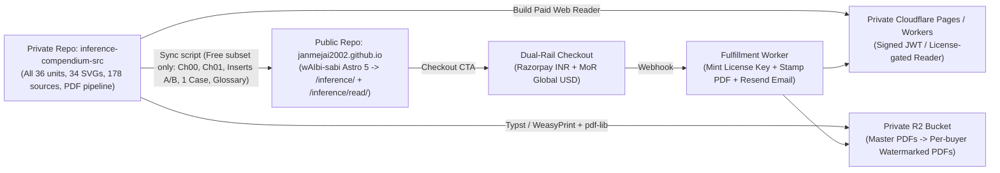
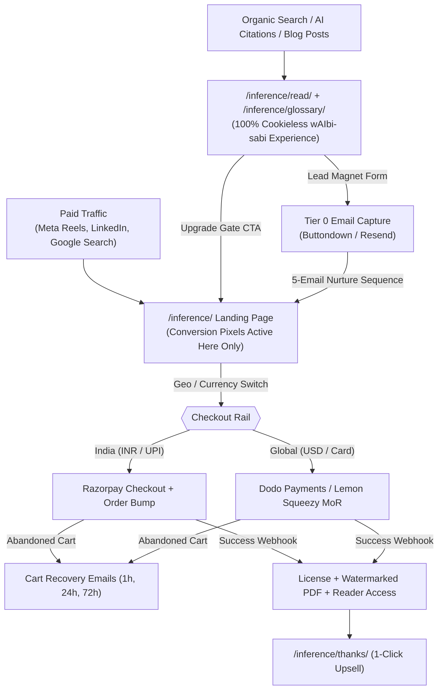

# INFERENCE — Productization, IP Protection & Paid-Funnel Blueprint

**Product:** INFERENCE AI Compendium (2027 Edition · `v1.0` Release Candidate)  
**Authors:** Janmejai Singh Minhas & Chaitanya Sharma  
**Host Ecosystem:** `wAIbi-sabi` (`https://janmejai2002.github.io`, Astro 5 static site, 131+ published applied-AI articles, `/news/` B-school archive)  
**Prepared:** 2026-11-28  
**Status:** Execution Blueprint (No `site/` code modified)

---

## Executive Summary & Strategic Diagnosis

INFERENCE already has what most info-products never build: **institutional-grade depth and verifiable craft**. Across **36/36 completed units** (Chapters 00–33 + Inserts A & B across Parts 0–IX), **150,033 words**, **84 media cards**, **116 glossary terms**, **34 zero-overflow SVG figures**, and **178 independently verified primary sources**, it sits cleanly above generic "AI prompt ebooks" and shallow MBA prep PDFs.

Right now, however, the asset has a **critical commercial vulnerability** and a **distribution bottleneck**:

1. **Zero IP Protection (Critical Commercial Risk):** The entire 150,033-word manuscript sits in a public GitHub repository (`https://github.com/janmejai2002/inference-compendium`) and is deployed publicly at `https://janmejai2002.github.io/inference-compendium/`. Paid ads cannot monetize a product whose full text is one Google search or `git clone` away.
2. **All-or-Nothing Packaging:** Without a curated Free Edition on `wAIbi-sabi` and modular domain SKUs, cold paid traffic faces a cold-start trust barrier, and organic B-school / practitioner searchers have no natural ladder from free discovery to paid purchase.
3. **Untapped Ecosystem Synergy:** `wAIbi-sabi` already runs an automated daily applied-AI publishing engine (`131` posts in `site/src/content/blog/`), a B-school interview news archive (`/news/`), an AI Deployment Claims Tracker (`/tracker/`), and a Prompt Caching Cost Calculator (`/tools/prompt-caching-calculator/`), with Umami Cloud (`UMAMI_WEBSITE_ID`) and Microsoft Clarity (`CLARITY_PROJECT_ID`) live in `site/src/seo.ts`. INFERENCE should become the flagship revenue spine sitting directly on top of this authority engine.

### Core Strategic Decisions

| Decision Axis | Choice | Strategic Rationale |
|---|---|---|
| **Repo & Hosting Split** | Move full 36-unit source + Paid Web Reader out of public GitHub Pages into a **private repo + authenticated CDN/Workers delivery**; keep a **curated Free Edition** inside `wAIbi-sabi` (`/inference/read/`). | GitHub Free does not serve Pages from private repos, and GitHub Pages cannot enforce paywalls. Moving `inference-compendium` off public Pages also frees `janmejai2002.github.io/inference-compendium/*` so `site/astro.config.mjs` can emit static SEO redirects. |
| **Free Edition Wedge** | Give away **5 high-signal assets** (~12–15% of total depth): Ch 00 (`ai-in-one-sitting`), Ch 01, Insert A (`State of Play Nov 2026`), Insert B (`India Briefing: DPDP, RBI FREE-AI, IndiaAI`), 1 flagship Casebook worked case, and the full **116-term Glossary**. | Proves craft immediately, dominates uncontested India + MBA placement SEO/AEO queries, and creates natural mid-intent upgrade gates into the paid domain tracks. |
| **Product Architecture** | **5-Tier Ladder** (Free Preview → Individual Domain Tracks → Full Compendium → Placement/Career Accelerator Bundle → B2B Campus/PlaceCom Bulk Licenses) with **INR PPP + Global USD pricing**. | Captures price-sensitive Indian MBA candidates (₹599–₹3,999 via UPI) alongside high-ARPU global PMs/consultants ($19–$119 via Merchant of Record), with Consulting (13 units) priced as the flagship modular track. |
| **Checkout & Tax Compliance** | **Dual-Rail Checkout:** **Razorpay** for India (INR, UPI Intent/QR, RuPay, NetBanking, GST invoices) + **Dodo Payments** (or Lemon Squeezy / Paddle) as **Merchant of Record (MoR)** for Global USD. | Eliminates multi-country VAT/US sales tax liability for India-based co-authors while maximizing Indian UPI checkout conversion (60–75% of domestic digital-product completions). |
| **Analytics & Cookie Firewall** | Keep main `wAIbi-sabi` blog **100% cookieless**; load Meta/LinkedIn/Google conversion pixels **only** on `/inference/` sales & checkout routes (or dedicated checkout domain). | Preserves `Base.astro` colophon integrity (*"Built with Astro and five dependencies; no cookies"*) while enabling full ROAS attribution and CAPI optimization on paid traffic. |

---

## 1. IP Protection & Repository Split Plan

### 1.1 Why Toggling the Repo Private Is Not Enough

Simply clicking *"Make private"* on `github.com/janmejai2002/inference-compendium` leaves four residual leaks:
1. **GitHub Pages persistence / teardown timing:** If GitHub Pages stays attached or cached, or if unpublishing creates dead 404s, backlinks break silently without passing link equity to `wAIbi-sabi`.
2. **Existing forks, search caches & AI training snapshots:** Any prior public commit SHA may exist in external clones, search engine snippets, or Wayback Machine captures.
3. **Free-vs-Paid source drift:** Maintaining free preview chapters in one repo and full chapters in another manually creates version drift whenever sources, SVG figures, or Inserts are updated.
4. **GitHub Free limitation:** Private repositories on GitHub Free cannot publish to GitHub Pages, and any static Pages deployment is inherently public without an auth proxy.

### 1.2 Target Multi-Repo & Delivery Architecture



### 1.3 Step-by-Step Transition Sequence (Zero-Leakage + Zero-SEO-Loss)

Execute in this exact order on a scheduled cutover day:

1. **Step 1 — Mirror & Clean-Room Private Repo Creation:**
   - Clone `janmejai2002/inference-compendium` locally and verify all 36 units, 84 media cards, 34 SVGs, 116 glossary terms, and 178 sources compile cleanly.
   - Create a **new private repository** (`janmejai2002/inference-compendium-pro`) with clean `v1.0` history (no public fork network attached). Transfer ownership or grant explicit repo/billing access to **Chaitanya Sharma** per the co-author agreement (§5.3).
   - Store all production assets (`chapters/`, `inserts/`, `casebooks/`, `figures/`, `glossary/`, `build-pdf/`, `audio/`) here.

2. **Step 2 — Export Free Edition Manifest to `wAIbi-sabi`:**
   - Add a `build:free-sync` script in `inference-compendium-pro` that reads an explicit `free-edition.manifest.json` (allowlist of public slugs) and copies **only** the approved Free Edition markdown, SVG figures, and glossary JSON into `janmejai2002.github.io/site/src/content/inference/` (and `site/src/data/glossary.json`).
   - Run a CI assertion in `inference-compendium-pro` verifying **no paid chapter slug** can ever enter the sync artifact.

3. **Step 3 — Tear Down Public Project Site & Reclaim URL Namespace:**
   - In `janmejai2002/inference-compendium` (the legacy public repo):
     - Disable GitHub Pages in **Settings → Pages** (unpublish `https://janmejai2002.github.io/inference-compendium/`).
     - Replace `README.md` with a clean archival notice pointing to `https://janmejai2002.github.io/inference/`, then **archive and set the legacy repo to Private** (or retain an empty stub repo solely if GitHub redirect hygiene requires it; once Pages is unpublished from the project repo, the user site `janmejai2002.github.io` immediately reclaims `/inference-compendium/*` paths!).

4. **Step 4 — Preserve Every Existing Link & Search Ranking via `site/astro.config.mjs`:**
   - `site/astro.config.mjs` (lines 52–55) already uses Astro static `redirects` (which emit HTML meta-refresh + `<link rel="canonical">` redirect stubs).
   - Map every previously public `/inference-compendium/*` route:
     - `/inference-compendium/` → `/inference/`
     - `/inference-compendium/chapters/00-ai-in-one-sitting/` → `/inference/read/ai-in-one-sitting/`
     - `/inference-compendium/chapters/01-.../` → `/inference/read/.../`
     - `/inference-compendium/inserts/state-of-play/` → `/inference/read/state-of-play-nov-2026/`
     - `/inference-compendium/inserts/india-briefing/` → `/inference/read/india-briefing/`
     - `/inference-compendium/glossary/` → `/inference/glossary/`
     - All **paid unit URLs** (`/inference-compendium/chapters/02-*` through `33-*`) → `/inference/?ref=legacy-redirect#tracks` (or domain-specific anchor `#track-consulting`, `#track-finance`, etc.).
   - Submit updated `sitemap-index.xml` in Google Search Console & Bing Webmaster Tools (`site/src/seo.ts`) and use Google Search Console's **Removals** tool for any full-text paid chapter URLs still showing cached snippets.

5. **Step 5 — Configure Crawler Posture (`site/public/robots.txt`):**
   - Keep `site/public/robots.txt` open to search/retrieval crawlers (`OAI-SearchBot`, `Claude-SearchBot`, `PerplexityBot`, `Googlebot`, `Bingbot`, `Google-Extended`) for `/inference/`, `/inference/read/*`, and `/inference/glossary/` so the Free Edition earns Google + AI search citations.
   - Ensure the **Paid Web Reader** lives on a separate origin/subdomain (e.g., `read.waibi-sabi` or Cloudflare Pages custom domain behind auth middleware) with `X-Robots-Tag: noindex, nofollow` on all authenticated routes and `User-agent: * Disallow: /` so no paid text is ever indexed even if a user shares a screenshot or URL.

---

## 2. Free Edition Architecture (`/inference/` & `/inference/read/`)

### 2.1 Integration Into `wAIbi-sabi` Site Structure

`wAIbi-sabi` currently has three primary nav items in `site/src/layouts/Base.astro` (lines 42–46):

```ts
const nav = [
  { href: '/', label: 'Blog' },
  { href: '/news/', label: 'BSchool' },
  { href: '/about/', label: 'About' },
];
```

**Recommended Navigation & Route Map:**
Add a fourth top-level tab in `Base.astro`: `{ href: '/inference/', label: 'INFERENCE' }` (placed between `BSchool` and `About`, or styled with a subtle `--ochre` gold mark matching `docs/DESIGN-SYSTEM.md`).

| Route | Purpose | `Base.astro` Layout Mode | Indexable? |
|---|---|---|---|
| `/inference/` | Standalone flagship sales & curriculum landing page (paid-ad destination) | `immersive={true}` (full-bleed `.pg-plate` + `.pg-edge`, per `docs/templates/new-page.astro.txt`) | Yes (`index, follow`) |
| `/inference/read/` | Free Edition reading hub (syllabus map showing Free vs Paid units across all 7 domains + Inserts) | `immersive={true}` | Yes (`index, follow`) |
| `/inference/read/<slug>/` | Full-text Free Edition reader pages (5 curated units, with inline SVG figures & natural upgrade gates) | Reading layout (`wide={false}`, `--measure: 44rem`, `grain={false}` per `Base.astro` line 35–37) | Yes (`index, follow`) |
| `/inference/glossary/` | Full 116-term searchable AI & Business Glossary (every term cross-linked to paid INFERENCE chapters & `wAIbi-sabi` blog posts) | `immersive={true}` | Yes (`index, follow`) |
| `/inference/campus/` | B2B / PlaceCom / Consulting Club bulk licensing inquiry & syllabus packet page | `immersive={true}` | Yes (`index, follow`) |
| `/inference/thanks/` | Post-checkout confirmation + license activation instructions | `noindex={true}` | No |

**Required Ecosystem Plumbing Updates (when implemented later):**
- `site/src/data/share.ts`: Register OG share cards (`inference`, `inference-read`, `inference-glossary`) obeying the `<300 KB` WhatsApp preview limit enforced by `site/scripts/check-build.mjs` (lines 74–80).
- `site/src/pages/llms.txt.ts`: Add an `## INFERENCE Free Edition` section linking `/inference/`, the 5 free units, and `/inference/glossary/` so AI coding/research agents discover the authoritative Free Edition.
- `site/scripts/check-design.mjs` compliance: Zero hardcoded hex/`rgb()` colors and zero non-system fonts inside `.astro` / `.css` files; use only `global.css` tokens (`--paper`, `--ink`, `--mizu`, `--ochre`, `--plum`, `--moss`, `--hanko`, `--indigo`, `--tldr-bg`, `--gold`) and `Inter` / `Newsreader`.
- **Voice Rule Compliance (`docs/DESIGN-SYSTEM.md` §Voice):** On-site copy must stay plain, dry, specific, sentence case, with **zero exclamation marks** and **zero `"unlock"` / `"dive in"` hype**. Upgrade CTAs use precise editorial framing (e.g., *"Continue to the 13-unit Consulting Track"*, *"Get the complete 150,033-word 2027 Edition"*).

### 2.2 Exact Free Edition Content Selection (5 Assets + Glossary)

Give away enough value that a skeptical IIM/ISB/XLRI candidate or engineering manager finishes thinking *"this is better than a ₹15,000 course"*, while leaving the **execution frameworks, domain playbooks, and full casebooks** behind the paywall.

| Free Asset | Unit / Scope | Why It Is Free (Strategic Job-to-be-Done) | Primary Conversion Bridge (Upgrade Gate) |
|---|---|---|---|
| **1. Foundations Opener** | **Ch 00 (`ai-in-one-sitting`)** | The 15-minute mental model of modern AI. Extremely shareable on LinkedIn/WhatsApp by MBA students during Day-0 prep; proves clarity without dumbing down inference/KV economics. | *"Ch 00 maps the terrain. Ch 02–07 teach you how to budget, evaluate, and judge production AI claims without getting fooled by vendor benchmarks → Read Foundations & Full Edition"* |
| **2. First Domain Bridge** | **Ch 01 (Foundations Unit 2)** | Shows the textbook's signature structural rhythm: primary-source citations, media cards, and zero-overflow SVG architecture diagrams. Eliminates "is the rest of the book just fluff?" anxiety. | *"Continue with Ch 02–07 (Foundations) or jump straight to your placement track →"* |
| **3. Global Pulse Anchor** | **Insert A (`State of Play — Nov 2026`)** | Time-stamped freshness proof (`Nov 2026`) backed by verified primary sources. Integrates natively with `wAIbi-sabi`'s `/tracker/` page. Doubles as the **Tier 0 downloadable PDF lead magnet**. | *"Insert A updates quarterly for Full Edition owners. Get the 2027 Edition with 1 year of Insert updates included →"* |
| **4. Uncontested India SEO Moat** | **Insert B (`India Briefing: DPDP Act, RBI FREE-AI, IndiaAI Mission`)** | Zero global AI books cover India's **DPDP Act**, **RBI FREE-AI framework**, and **IndiaAI Mission** with 178-source rigor. Captures high-intent Indian B-school GDPI, RBI/fintech, and GCC leadership organic search traffic at ₹0 CAC. | *"Pair India regulatory reality with the 4-unit Finance Track or 13-unit Consulting & Strategy Track →"* |
| **5. Placement ROI Proof** | **1 Flagship Worked Case from the Consulting AI Casebook** | Shows a complete, interview-grade AI deployment case breakdown (problem framing, unit economics, build-vs-buy, failure modes, boardroom rubric). Proves INFERENCE wins actual shortlists and interviews. | *"This is 1 of 13 units in the Consulting & Strategy Track (plus 4 domain casebooks across Marketing, Product, Operations, Finance & HR) →"* |
| **6. Programmatic AEO Engine** | **Full 116-Term Glossary (`/inference/glossary/`)** | 116 authoritative definitions (`KV cache`, `RLVR`, `DPDP`, `FREE-AI`, `Speculative Decoding`, etc.) engineered for featured snippets and AI assistant citations. Every term card cites its parent paid unit + links to related free `wAIbi-sabi` blog posts. | Inline badge on every definition: *"Applied in Ch 14 (Consulting) · Full framework in Paid Edition →"* |

**What Stays 100% Paid (31/36 Units Protected):**
- Foundations Ch 02–07 (`judging-output` and core technical-to-business translation layers — *except* bundled selectively or sold in Full/Track packs; see §3.2).
- **12 of 13 units** in Consulting & Strategy (`who-pays`, `pilots-stall`, `work-changes`, `consulting-firm`, `interview-room`, remaining `ai-casebook` cases).
- **All 4 units each** in Marketing, Product, Operations, Finance, and HR & People (20 domain-specialized units + domain casebooks).
- All downloadable **A4 print-grade PDFs**, **84 full-resolution media card decks**, **34 vector/SVG figure packs**, and **Audio / Flashcard / Drill add-ons**.

### 2.3 Upgrade Gate UX Inside `/inference/read/<slug>/`

Never use jarring popups or darkened paywall overlays on free chapters. Use `wAIbi-sabi`'s editorial vocabulary:

1. **Inline Track Map Bar (Top of `/inference/read/<slug>/`):** Shows `Part / Track · Free Preview (1 of 5 free units)` with a quiet `--ochre` progress indicator showing how the unit sits inside the 36-unit architecture.
2. **Mid-Article Contextual Callout (after major insight, max 1 per page):** Uses `.card` (`--stone` / `--border` with a 6px `--ochre` diamond marker per `docs/DESIGN-SYSTEM.md`):
   - Example on **Insert B**: *"Preparing for fintech or consulting interviews? Insert B is the regulatory baseline. The Finance Track (4 units) covers credit-risk AI governance, margin math, and deployment failures in full."* + CTA `[See the Finance Track — ₹699 / $19]` and quiet secondary link `Or get all 36 units →`.
3. **End-of-Chapter "Next Unit" Gate (Bottom of `<article>`):**
   - Renders the **next locked unit's actual title, word count, figure count, and 3-bullet learning outcomes** in a crisp `tldr-bg` dark ceramic plate (using `.plate` + `plateEdge()`), followed by two clear paths:
     - **Primary:** `"Get the [Track Name] Track"` or `"Get the Full 36-Unit Edition"` (links to `/inference/?track=<id>&src=<slug>#pricing`).
     - **Secondary (Zero-Friction Capture):** `"Send me the Insert A + B Printable Cheat Sheet (Free PDF)"` → opens inline email capture (Tier 0 Lead Magnet).

---

## 3. Product Ladder & Modular SKU Pricing (INR PPP + Global USD)

### 3.1 Pricing Philosophy & PPP Calibration

- **India Anchor (`₹` INR):** Indian Tier-1/Tier-2 MBA students (IIMs, XLRI, ISB, SPJIMR, FMS, MDI) routinely spend ₹1,500–₹4,000 on case-comp prep, CAT/GDPI mentors, and interview compendiums, and pay instantly via UPI without hesitation below **₹2,500** for a flagship reference. Pricing individual 4-unit modules at **₹599–₹699** creates an easy impulse buy, while pricing the **Full 36-unit Compendium at ₹2,499** (launch/early-bird ₹1,999) makes upgrading from 2 modules mathematically obvious.
- **Global Anchor (`$` USD):** Global consultants, PMs, MBA candidates (US/EU/UK/SG), and corporate L&D buyers benchmark dense, 150k-word specialist technical/strategy handbooks against O'Reilly/Reforge/Maven materials ($49–$149). Global pricing applies a **~3.4x–3.8x PPP multiplier** (`$19` domain module, `$69` Full Compendium, `$119` Career Accelerator) — protecting margins against MoR fees (~5% + $0.50) and paid-ad CPCs ($1.50–$4.50 on LinkedIn/Google).

### 3.2 Complete 5-Tier Product Ladder

| Tier | SKU Name | Exact Contents | India Price (INR) | Global Price (USD) | Strategic Role |
|---|---|---|---|---|---|
| **Tier 0** | **Free Web Edition + Placement Cheat Sheet** | 5 free units (`/inference/read/`) + 116-term Glossary + downloadable **"2027 AI Executive & Interview Cheat Sheet (PDF)"** (condensed Insert A + Insert B + 15 Must-Know AI Metrics) | **₹0** (Email required for PDF) | **$0** (Email required for PDF) | Top-of-funnel trust builder & email list capture |
| **Tier 1A** | **Domain Module (4-Unit Tracks):**<br>• Finance<br>• Marketing<br>• Product<br>• Operations<br>• HR & People | All **4 units** of the chosen domain (including its domain Casebook) **+ Ch 00 & Ch 01 + Foundations Executive Summary** + Domain Glossary Extract + Watermarked A4 Module PDF + Private Web Reader access | **₹699**<br>*(Launch: ₹599)* | **$19**<br>*(Launch: $15)* | Low-friction paid entry for specialists & non-consulting role tracks |
| **Tier 1B** | **Flagship Domain Module:**<br>• **Consulting & Strategy Track (13 Units)** | All **13 units** (`who-pays`, `pilots-stall`, `work-changes`, `consulting-firm`, `ai-casebook`, `interview-room`, + Inserts A & B) + Ch 00–01 + Watermarked A4 PDF + Private Web Reader | **₹1,299**<br>*(Launch: ₹999)* | **$39**<br>*(Launch: $29)* | Highest-volume modular SKU for Indian & global MBA consulting prep |
| **Tier 2** | **INFERENCE Full Compendium (2027 Edition v1.0)** | **All 36/36 units** (150,033 words across Parts 0–IX: Foundations Ch 00–07 + all 6 Domain Tracks + Inserts A & B) + **34 SVG figures** + **84 media cards** + A4 Print-Grade Watermarked PDF + Private Web Reader + **1 Year of Quarterly Insert Updates** | **₹2,499**<br>*(Launch: ₹1,999)* | **$69**<br>*(Launch: $59)* | **Core Revenue Driver** (Target ≥60% of B2C revenue) |
| **Tier 3** | **Placement & Career Accelerator Bundle** | Everything in **Tier 2** + **116-Term Anki / Interactive Flashcard Deck** + **25 Prompt & AI Case Interview Drills with Scoring Rubrics** + **Audio Briefings (MP3/Podcast RSS feed for all 36 units)** + **100% Upgrade Credit guarantee** | **₹3,999**<br>*(Launch: ₹3,299)* | **$119**<br>*(Launch: $99)* | High-margin AOV maximizer (Zero marginal COGS) |
| **Tier 4** | **B2B / Campus / PlaceCom & Club Bulk Licenses** | Full Compendium (Tier 2) or Accelerator (Tier 3) seat packs with **Custom Campus/Club Cover Stamp**, **Single GST Tax Invoice**, **PlaceCom/Club Coordinator Redemption Sheet**, and optional **60-min Live Q&A / Workshop with Janmejai & Chaitanya** | **25 seats:** ₹35,000<br>**100 seats:** ₹1,10,000<br>**Batch (300–600):** ₹2,25,000–₹3,50,000 | **25 seats:** $990<br>**100 seats:** $2,900<br>**Cohort (300+):** Custom ($5,500+) | Lump-sum institutional cashflow & word-of-mouth moat across IIMs/XLRI/ISB/global clubs |

### 3.3 Bundling & Decoy Logic (Why Customers Upgrade to Tier 2 & Tier 3)

1. **Prerequisite Inclusion on Tier 1:** Every 4-unit Tier 1 module includes **Ch 00, Ch 01, and a 12-page Foundations Primer PDF** so a Finance or HR buyer never feels dropped mid-stream without understanding tokens, evals, or latency economics.
2. **2-Track Upgrade Rule (The Pricing Squeeze):**
   - Buying **Consulting (₹1,299)** + **Product (₹699)** = **₹1,998** (only 17 units).
   - Buying **Full Compendium Launch (₹1,999)** / **Standard (₹2,499)** unlocks **all 36 units + 1-year Insert updates**.
   - **Rule baked into checkout UI:** If a visitor selects 2+ tracks in the cart, automatically surface a banner: *"Two tracks cost ₹1,998. Add ₹1 (₹501 standard) for all 6 tracks, Foundations Ch 02–07, and 1 year of Insert updates."*
3. **14-Day 100% Upgrade Credit:** Any Tier 1 buyer receives a unique coupon/credit code worth **100% of what they paid** toward Tier 2 or Tier 3 within 14 days of purchase. This turns Tier 1 into a risk-free paid trial that systematically upgrades buyers into Tier 2/3.
4. **Order Bump & Post-Purchase Upsell Math:**
   - **Order Bump (on Tier 1 / Tier 2 checkout):** Add the **Interview Rubric Flashcards & 25 Case Drills Pack** for **+₹499 INR / +$15 USD** (pre-selected unchecked box on checkout; expected 22–30% take rate).
   - **Post-Purchase 1-Click Upsell (on `/inference/thanks/`):** For Tier 1 buyers → *"Upgrade to Full 36-Unit Edition right now for the difference (₹1,200 / $30) + get the Audio Briefings included."*

---

## 4. End-to-End Paid-Ad Sales Funnel Blueprint (`/inference/`)

### 4.1 Funnel Architecture & Pixel Isolation



> **Cookie & Brand Firewall:** `site/src/layouts/Base.astro` states *"Built with Astro and five dependencies; no cookies."* Keep Meta Pixel / LinkedIn Insight Tag / Google Ads `gtag` **strictly excluded** from `Base.astro` on all blog/news/about routes. Load ad-conversion scripts **only** via an optional `adPixels?: boolean` prop on `/inference/` and `/inference/thanks/` (or solely on the checkout gateway + server-side Conversions API webhooks) so the core editorial journal remains zero-cookie.

### 4.2 Section-by-Section Wireframe & Copy Strategy (`/inference/`)

All visual containers inherit `docs/DESIGN-SYSTEM.md` (`--tldr-bg` dark plate with `plateEdge('inference')` gold fracture, `--paper` body, `--ochre`/`--mizu`/`--moss`/`--hanko`/`--plum` track accents, `Inter` 800 headings, `Newsreader` serif questions/quotes).

1. **Section 1 — Dark Ceramic Hero Plate (`.pg-plate` + `.pg-edge`):**
   - **Eyebrow (`.hanko`):** `INFERENCE · 2027 EDITION (v1.0)`
   - **H1 (`Inter 800`):** `The applied AI compendium for people who sit in business, product, and placement rooms.`
   - **Subheadline (`Newsreader`):** `36 units. 150,033 words. 34 diagrams. 178 verified primary sources. Built for consulting, finance, product, marketing, operations, and HR decisions—not model-builder hype.`
   - **Ad-to-Page Message Match Slot (Dynamic Query Param `?angle=`):** Vanilla JS reads `?angle=mba` or `?angle=exec` (with clean default) to swap the 1-line kicker above the fold:
     - `?angle=mba`: *"Built for 2026–27 B-school SIP, Finals, and AI case interviews across consulting, finance, and PM."*
     - `?angle=exec`: *"Built for operators, PMs, and consultants auditing AI margins, governance, and deployment failures."*
   - **Primary CTA:** `[Get the 2027 Edition — from ₹599 / $15]` (scrolls to `#pricing`)
   - **Secondary CTA (`.linkish`):** `Read 5 units free first →` (`/inference/read/`)
   - **Proof Strip:** `36/36 Units Complete · 116-Term Glossary · 178 Primary Sources · Dual-Rail Instant Delivery (UPI / Global Card)`

2. **Section 2 — "Why Generic AI Content Fails You" (Problem Agitation, 3-Column Grid):**
   - Contrast **Newsletters/Threads** (chasing weekly model releases, zero unit economics) and **Engineering Textbooks** (PyTorch/CUDA math irrelevant to boardrooms and case interviews) against **INFERENCE** (mechanism → margin math → real failure modes → interview/executive rubric).
   - Anchor with a crisp `--hanko` claim strip pulled from wAIbi-sabi's DNA: *"Every claim is source-linked. Zero synthetic case studies."*

3. **Section 3 — Interactive Chapter & Track Explorer Widget (Zero-Framework JS):**
   - Modeled after `/tools/prompt-caching-calculator.astro`: pure semantic HTML + lightweight vanilla JS tabs with zero external dependencies.
   - **Tab 1 — 7-Track Curriculum Matrix:** Click any track (`Foundations [8]`, `Consulting [13]`, `Finance [4]`, `Marketing [4]`, `Product [4]`, `Operations [4]`, `HR & People [4]`, `Inserts [2]`) to inspect every unit slug, word count, key diagram, and sample interview question.
   - **Tab 2 — Live Zero-Overflow SVG Figure Preview:** Renders 1 real SVG diagram from INFERENCE using wAIbi-sabi's light/dark CSS tokens so visitors see the publication-grade visual standard in both themes.
   - **Tab 3 — Casebook & Rubric Excerpt:** Interactive toggle showing an abbreviated worked case + grading rubric from `ai-casebook` + link to read the full free case at `/inference/read/`.
   - **Tab 4 — 116-Term Glossary Live Search:** Instant client-side filter over sample terms showing definition + chapter reference.

4. **Section 4 — Author & Institutional Authority Bridge (`wAIbi-sabi` + Primary Evidence):**
   - Side-by-side author credentials (pulled accurately from `/about/` for Janmejai Singh Minhas — AmEx Risk Modelling, published clinical CV research in Elsevier/Springer, Gray Swan AI red-teaming, XLRI; paired with co-author **Chaitanya Sharma**'s verified bio/credentials).
   - **Authority Bridge Box:** *"Written by the team behind wAIbi-sabi (131+ source-graded AI analyses, live AI Claims Tracker, and daily B-school intelligence archive)."* Links transparently to `/about/` and `/tracker/` so skeptical visitors can audit the authors' writing quality before buying.

5. **Section 5 — Social Proof & Beta Reader Verification Grid:**
   - 4–6 structured, named/role-tagged quotes from beta readers (MBA candidates from IIM/XLRI/ISB + industry PMs/analysts) highlighting **specific outcomes** (*"Used the `pilots-stall` unit and Insert B RBI FREE-AI breakdown in my fintech shortlist round"*). *(Must be populated during §5.5 Beta Seeding before paid ads launch.)*

6. **Section 6 — Pricing & Modular SKU Matrix (`#pricing`):**
   - **Top Currency Switch:** Clean segmented pill: `[India · ₹ INR (UPI / Cards)]` vs `[International · $ USD (Card / Apple Pay)]` (auto-initialized via timezone/locale hint `Asia/Calcutta` / `Asia/Kolkata`, always user-overridable).
   - **3 Primary Cards** (Tier 1 Modular Selector dropdown inside Card 1, Tier 2 Full Compendium highlighted with `--ochre` border as `"Most Complete"`, Tier 3 Career Accelerator) + compact bar below for **Tier 4 Campus / PlaceCom Bulk Licenses** (`/inference/campus/`) + quiet text link for **Tier 0 Free Edition** (`/inference/read/`).

7. **Section 7 — 7-Day Evidence-First Guarantee:**
   - *"Read Chapters 00–05 and a full domain track. If INFERENCE does not sharpen how you frame AI economics, cases, or deployment decisions within 7 days, email us your order ID for a 100% refund—no forms, no debate."*

8. **Section 8 — Objection-Crushing FAQ (With Schema.org `FAQPage` JSON-LD via `SEO.astro`):**
   - *"How is this different from ChatGPT or free AI blogs?"* (Structured 150k-word curriculum, 178 verified primary sources, domain-specific interview rubrics, zero hallucinations).
   - *"I'm not a coder/engineer—will I follow it?"* (Designed specifically for MBA/consulting/business tracks; Ch 00–07 translate mechanics into business decisions).
   - *"Will the book go stale in 3 months?"* (Core architecture & business unit economics stay durable; Tier 2/3 include 1 year of quarterly Insert A/B updates).
   - *"Can I buy one track now and upgrade later?"* (Yes — 100% of your Tier 1 purchase applies as credit toward Tier 2/3 within 14 days).
   - *"Do you offer GST invoices or college club discounts?"* (Yes — GST invoices via Razorpay and bulk packs starting at 25 seats on `/inference/campus/`).

### 4.3 Dual-Rail Checkout, Tax Compliance & Delivery Flow

| Dimension | India Rail (`₹ INR`) | Global Rail (`$ USD`) |
|---|---|---|
| **Provider** | **Razorpay** (Payment Pages / Standard Checkout) | **Dodo Payments** *(Recommended for India founders)* or **Lemon Squeezy / Paddle** |
| **Why This Choice** | Best UPI Intent/QR completion rates on mobile Instagram/LinkedIn traffic; supports RuPay, NetBanking, Wallets, EMI, and Indian GST invoices. | Acts as **Merchant of Record (MoR)**: calculates, collects, and remits US state sales tax, EU VAT, UK VAT, and Australia GST automatically, then wires clean payouts to India via wire/SWIFT/local settlement with FIRC/compliance support. |
| **Fee Reality** | ~2.0% + 18% GST on fee (~2.36% effective). | ~4–5% + $0.40–$0.50 per txn (varies by card/region), zero multi-country tax headache. |
| **Currency Routing** | User selects India toggle (or `Intl.DateTimeFormat().resolvedOptions().timeZone === 'Asia/Kolkata'`), routes to Razorpay checkout modal/page with SKU metadata (`sku_id`, `utm_source`, `utm_campaign`). | Non-India visitors route to MoR hosted overlay/checkout with identical SKU metadata passed via custom fields. |
| **Webhook Fulfillment** | `payment.captured` webhook → Cloudflare Worker verifies HMAC signature → generates personalized PDF + license key → sends transactional email via Resend/Postmark → redirects to `/inference/thanks/`. | `payment.succeeded` / `order_created` webhook → same Cloudflare Worker fulfillment pipeline. |

### 4.4 Abandoned-Cart & 5-Email Nurture Sequences

**Trigger A — Tier 0 Lead Magnet (Free Cheat Sheet / State of Play PDF) → 5-Email Nurture Sequence (Days 0, 2, 4, 7, 10):**
1. **Day 0 (Immediate):** Deliver the **2027 AI Executive & Interview Cheat Sheet PDF** + direct link to Ch 00 (`/inference/read/ai-in-one-sitting/`). Zero hard pitch.
2. **Day 2 (Value Proof):** *"The single question that exposes 90% of AI pitches in consulting interviews"* — 300-word breakdown from `pilots-stall` + link to the free worked Casebook case.
3. **Day 4 (India / Market Edge):** *"What RBI FREE-AI and India's DPDP Act actually forbid (and allow)"* — excerpt from Insert B (`/inference/read/india-briefing/`) + soft CTA to domain tracks (`₹599 / $15` launch).
4. **Day 7 (Objection Buster + Case Math):** Show 1 full SVG figure preview + explain the **14-day 100% Upgrade Credit** (start with 1 domain track, upgrade risk-free).
5. **Day 10 (Direct Close):** Side-by-side comparison of Tier 1 vs Tier 2 Full Compendium + 7-day guarantee reminder.

**Trigger B — Checkout Abandonment (Email captured at Step 1 of Razorpay/MoR checkout) → 3-Touch Recovery (1h, 24h, 72h):**
- **+1 hour:** *"Your INFERENCE [Track/Edition] link is saved"* — zero discount, asks if UPI/card failed and links directly to Ch 00 + FAQ.
- **+24 hours:** *"Here is one sample page from inside [Track Name]"* — attaches 2-page PDF preview + 7-day refund guarantee.
- **+72 hours:** *"Start with one track? (100% credited if you upgrade)"* — down-sells Tier 2/3 abandoners to Tier 1 (`₹599 / $15`) to convert them into paying customers inside the upgrade window.

### 4.5 Top 5 Paid Ad Angles & Creative Briefs

| # | Audience & Channel | Core Hook / Headline | Creative Format & Visual Brief | Landing Match & Target Economics |
|---|---|---|---|---|
| **1** | **Indian MBA Placement Season (IIM / XLRI / ISB / SPJIMR / FMS)**<br>*Meta / Instagram Reels + Stories* | *"Stop quoting ChatGPT wrappers in your SIP/Final AI interviews. Know the unit economics interviewers actually grill."* | **30s Founder-to-Camera Reel:** Janmejai holds a clean A4 printed copy / iPad showing one of the **34 SVG figures** + **Insert B (RBI FREE-AI / DPDP)**. Quick cuts across 3 stats: `150,033 words · 178 sources · ₹599/track`. | `/inference/?angle=mba#pricing`<br>Target CPC: ₹6–₹14<br>Target CPA (Tier 1/2): ₹450–₹800 |
| **2** | **Consulting & Strategy Aspirants (MBB / Tier-1 Prep)**<br>*LinkedIn Single Image + Carousel + Meta* | *"13 units on where enterprise AI pilots stall, who actually pays, and how to break an AI case in 20 minutes."* | **6-Slide Document Carousel:** Slide 1: Dark ceramic cover (`--tldr-bg` + gold kintsugi seam). Slides 2–5: Actual Consulting Casebook framework + SVG architecture excerpt. Slide 6: *"Read 1 full case free before buying."* | `/inference/read/` (Free Casebook) or `/inference/?angle=mba&track=consulting#pricing` |
| **3** | **Global PMs, Consultants & Finance Leaders**<br>*LinkedIn Sponsored Content + X/Newsletter* | *"150,000 words of applied AI economics, governance, and 178 primary sources—zero prompt-list fluff."* | **Clean Editorial Static Card:** High-contrast dark slate (`#15181D`) + ochre rule showing the **7 Domain Tracks** table + 178 verified sources badge. | `/inference/?angle=exec#pricing`<br>Target CPA (Tier 2/3 $59–$119): $18–$35 |
| **4** | **High-Intent Problem Searchers**<br>*Google Search Ads (Exact/Phrase)* | Keywords: `"ai case interview prep"`, `"ai consulting framework pdf"`, `"rbi free ai framework summary"`, `"enterprise ai roi case study"` | **Responsive Search Ads (RSA):** Highlight `"150k-Word Applied AI Compendium · Read 5 Units Free · 178 Verified Sources"`. Sitelinks to `Free Glossary`, `Consulting Track`, `Insert B India Briefing`. | `/inference/read/india-briefing/` (for regulatory queries) or `/inference/` (for prep/compendium queries) |
| **5** | **Warm Retargeting (Free Readers & Cart Abandoners)**<br>*Meta + LinkedIn Retargeting (7-day & 30-day pools)* | *"You read Chapter 00 / the Glossary. Ready for the 6 domain casebooks and 34 diagrams?"* | **15s Page-Flip Video / Testimonial Card:** Screen recording scrolling smoothly through the A4 PDF + Web Reader + beta-reader quote + 7-day guarantee badge. | `/inference/#pricing` (with 100% Upgrade Credit & Guarantee emphasized) |

**Paid Media Guardrails (Preventing Burn Before Product-Market Fit):**
- Never turn on cold Meta/LinkedIn ads until **§5 Finishing Checklist** is 100% green AND organic/beta conversions confirm ≥2.5% landing-page-to-checkout conversion.
- Start with **₹1,000/day ($12/day) test sprints** split across Angle 1 (India MBA) and Angle 4 (Google Search), killing any creative below `1.2%` CTR (Meta) / `0.6%` CTR (LinkedIn) after 3,000 impressions.

---

## 5. Finishing Checklist ("100% Finished & Sellable")

Nothing ships to paid traffic until every gate below is checked off:

### 5.1 PDF Watermarking & Buyer-Stamping Pipeline
- [ ] **Deterministic Build Pipeline:** Compile print-grade A4 PDFs (Full Compendium + 6 Domain Module PDFs + Tier 0 Cheat Sheet) from the private `inference-compendium-pro` repo using Typst or Playwright/WeasyPrint with embedded `Inter` and `Newsreader` fonts and crisp vector SVGs.
- [ ] **Per-Buyer Stamping on Webhook:** Use `pdf-lib` (inside a lightweight Cloudflare Worker / Node serverless endpoint) to stamp **every downloaded PDF** dynamically in <1.5 seconds:
  - Subtle bottom-margin footer on every page: `Licensed to <Buyer Name> (<buyer@email>) · Order <order_id> · Personal Non-Transferable Copy`
  - Embedded PDF Document Metadata (`Subject`, `Keywords`, custom `X-License-Hash` SHA-256 of `order_id + email + salt`) for leak tracing if a file surfaces on Telegram/Drive.
- [ ] **Caching / Abuse Limit:** Cap download link regeneration to 5 downloads per order (`24-hour` expiring signed R2 URLs) with self-serve re-issue via email lookup.

### 5.2 License Key & Automated Delivery Infrastructure
- [ ] **License Ledger (Cloudflare D1 / Supabase Postgres):** Store `order_id`, `provider` (`razorpay` | `dodo`), `sku_id`, `buyer_email`, `buyer_name`, `amount_currency`, `license_key` (`INF-2027-XXXX-XXXX`), `allowed_tracks[]`, `upgraded_from_order_id`, and `created_at`.
- [ ] **Gated Private Web Reader:** Deploy paid web edition on private Cloudflare Pages + Worker session middleware: buyer enters `email + license_key` once → receives an `HttpOnly` 30-day session cookie scoped to `allowed_tracks[]` (or all 36 units for Tier 2/3).
- [ ] **Transactional Email Delivery (`Resend` / `Postmark`):** Within 10 seconds of payment capture, send a clean branded receipt containing: (1) License Key, (2) Direct Web Reader magic link, (3) Download button for watermarked PDF, (4) GST/MoR invoice link, and (5) 14-day 100% Upgrade Credit code (if Tier 1).

### 5.3 Co-Author Agreement Checklist (Janmejai Singh Minhas & Chaitanya Sharma)
Execute a signed, plain-English **Co-Author & Commercial Revenue Agreement** before opening paid checkout:
- [ ] **IP Ownership & Copyright Split:** Confirm joint copyright allocation (e.g., 50/50 or agreed percentage) on the INFERENCE manuscript, figures, and brand, while explicitly carving out `wAIbi-sabi` blog infrastructure (`janmejai2002.github.io`) as Janmejai's sole existing property.
- [ ] **Net Revenue & Cost Waterfall:** Define exact payout formula: `Gross Sales` − `Payment/MoR Fees & GST/Taxes` − `Approved Paid Ad Spend & SaaS Infra (R2/Resend/Reader)` = `Net Distributable Profit`, split per agreed ratio on a monthly settlement schedule (e.g., 5th of each month).
- [ ] **Decision Rights & Pricing Authority:** Designate clear sign-off rules for discounting, B2B/PlaceCom bulk deals (Tier 4), corporate sponsorships, and refund thresholds.
- [ ] **Maintenance & Update SLA:** Assign ownership for quarterly **Insert A & Insert B** updates during the 1-year update window promised to Tier 2/3 buyers.
- [ ] **Withdrawal / Buyout / Sunset Clause:** Define what happens if one co-author stops maintaining updates or wishes to step back (revenue share on existing edition vs reduced share on subsequent `v2.0` editions).
- [ ] **Tax & Payout Compliance:** Clarify who holds the Razorpay/MoR merchant account, how GST/income tax on gross receipts is accounted for before co-author remittance (TDS/contractor invoice if applicable under Indian tax rules).

### 5.4 Edition Versioning, Changelog & Radical-Honesty Errata
- [ ] **Semantic Edition Tagging:** Promote `2027 Edition 1.0 Release Candidate` → **`v1.0.0` (GA)** on launch day; track all future fixes in a public `/inference/changelog/` page (`v1.0.1` errata, `v1.1.0` Q1 2027 Insert A/B update).
- [ ] **Public Errata Ledger:** Mirror `wAIbi-sabi`'s core differentiator (*"evidence is graded and corrections are published, not hidden"*) with a clean error-report email/form so readers who spot an outdated stat or typo get credited in the changelog.

### 5.5 Testimonials, Beta-Reader Seeding & Pre-Launch Proof
- [ ] **14-Day Closed Beta Cohort (Target: 20–30 Readers):** Seed free watermarked full copies to 15–20 MBA peers (XLRI, IIMs, ISB, SPJIMR, FMS) and 5–10 industry operators (AmEx, consulting, PM, finance) in exchange for **structured written feedback + permission to quote with Name, Role/School, and Track read**.
- [ ] **Minimum Proof Gate Before Paid Ads:** Collect at least **6 high-specificity testimonials** (3 MBA placement-focused, 3 practitioner/executive-focused) plus **3 quantified engagement metrics** (e.g., average rating, % who found a case framework interview-ready) to populate `/inference/` Section 5.
- [ ] **Campus Ambassador / PlaceCom Warm Outreach:** Share a dedicated Tier 4 review packet with 5–10 target B-school Consulting & ProdMan clubs before peak SIP/Finals windows.

---

## 6. Phased Execution Roadmap (30-Day Launch Sprint)

| Phase | Timeline | Concrete Deliverables | Exit Gate |
|---|---|---|---|
| **Phase 1: IP Lockdown & Repo Split** | Days 1–5 | Create private `inference-compendium-pro` repo; unpublish legacy public GitHub Pages; add `redirects` in `site/astro.config.mjs`; sign Co-Author Agreement with Chaitanya. | Public `janmejai2002.github.io/inference-compendium/` no longer exposes paid units; legacy URLs redirect cleanly. |
| **Phase 2: Free Edition & Sales Page** | Days 6–14 | Build `/inference/`, `/inference/read/` (5 free units), `/inference/glossary/` (116 terms), `/inference/campus/`, OG cards (`share.ts`), and `llms.txt.ts` updates; pass `npm --prefix site run build` (`check-build` + `check-design`). | 5 free units live, zero design-token violations, cookie isolation verified on blog routes. |
| **Phase 3: Checkout, Watermarking & Beta** | Days 15–22 | Deploy Cloudflare Worker fulfillment + `pdf-lib` watermarking + private Web Reader + Razorpay (INR) & Dodo Payments/Lemon Squeezy (USD) webhooks + Resend emails; run 20–30 person Beta Cohort & collect testimonials. | End-to-end ₹1 / $1 live test purchase delivers watermarked PDF + working Reader login in <15s; 6+ beta quotes live. |
| **Phase 4: Soft Launch & Paid-Ad Scale** | Days 23–30 | Launch Tier 0 Lead Magnet + 5-email nurture; post organic launch thread on LinkedIn/`wAIbi-sabi`; initiate ₹1,000/day controlled paid tests on Angle 1 (Meta MBA) & Angle 4 (Google Search); pitch first 5 campus clubs (Tier 4). | Positive contribution margin on paid test cohorts; 14-day upgrade loop & abandoned-cart recovery active. |
