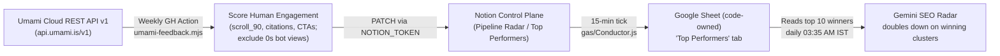

# Strategic Monetisation, Open-Source Stack & Umami Telemetry Architecture
**Prepared for:** Janmejai Singh Minhas (Founder, wAIbi-sabi & Co-Author, INFERENCE)  
**Perspective:** Chief Strategy Officer + Principal Platform Architect  
**Date:** 2026-11-28  
**Scope:** `wAIbi-sabi` (`https://janmejai2002.github.io`) & `INFERENCE` AI Compendium  

---

## Executive Summary

`wAIbi-sabi` and `INFERENCE` already possess what 99% of technical publications lack: **verifiable proof-of-work** (133 published applied-AI articles in the live corpus, 131 markdown sources in the current branch snapshot, 708 B-school interview news entries in [`site/src/data/news.json`](../../site/src/data/news.json), the [`/tracker/`](../../site/src/pages/tracker.astro) AI claims ledger, [`/tools/prompt-caching-calculator/`](../../site/src/pages/tools/prompt-caching-calculator.astro), and an autonomous Gemini → Google Sheet → Notion → GitHub publishing harness), paired with rare **practitioner credentials** (American Express Credit Risk modelling, peer-reviewed Elsevier/Springer medical computer vision, Gray Swan `#352` global rank with 36 unique model breaks, and XLRI MBA positioning) and a **flagship intellectual-property asset** (`INFERENCE`: 150,033 words, 36 units, 7 domains, 178 verified sources, 34 SVG figures, 116 glossary terms, co-authored with Chaitanya Sharma).

Building on [`docs/MONETISATION-PLAN.md`](../MONETISATION-PLAN.md) — whose core diagnosis ("monetise credibility first, build capture in parallel, defer mass sponsorships until subscriber gates are crossed") remains sound — this report resolves three strategic questions:

1. **Revenue Architecture (Part 1):** Evaluates **11 distinct revenue engines** across 4 time horizons, prioritizing **3 immediate high-leverage engines** (High-Ticket AI Red-Teaming & Eval Retainers, INFERENCE Modular + Full B2C Launch, and Campus/PlaceCom B2B Bulk Licenses) that collectively target **₹18L–₹45L ($22K–$54K) in realistic Year-1 revenue** without diluting editorial trust.
2. **Open-Source Stack (Part 2):** Audits **15 verified, actively maintained GitHub OSS projects** mapped to exact integration points across Astro 5, PDF stamping/typesetting, static search, CI link/performance gates, newsletter infrastructure, and GEO discovery.
3. **Umami Cloud & Telemetry Loop (Part 3):** Fixes a **live duplicate-tracking bug** discovered in [`site/src/layouts/Base.astro`](../../site/src/layouts/Base.astro#L53-L60) vs [`site/src/components/SEO.astro`](../../site/src/components/SEO.astro#L253-L262) (Microsoft Clarity `zep5vkb77s` is injected twice in production and sets cookies despite the `"no cookies"` colophon), specifies a 9-event Umami taxonomy, designs human-vs-bot segmentation (filtering 0-second Singapore datacenter hits), and provides the full architecture and code design for `site/scripts/umami-feedback.mjs` to close the Radar topic loop.

---

## Part 1: Business Strategy — Complete Revenue Stream Ideation

### 1.1 Strategic Premise & Co-Authorship Governance

* **Zero-Threshold vs Audience-Gated Engines:** Advertising/sponsorships require scale (1,000+ engaged subscribers minimum for flat $50–$250 placements; 30K+ for $140–$220 CPMs per [`docs/MONETISATION-PLAN.md`](../MONETISATION-PLAN.md)). Advisory retainers, B2B campus licenses, and flagship digital products (INFERENCE) monetise **credibility and utility**, which have a zero subscriber floor.
* **IP & Revenue Split Firewall:** `INFERENCE` is co-authored with **Chaitanya Sharma**. Before opening checkout, formalize a simple 1-page revenue-sharing agreement covering: (a) net revenue split after payment gateway/tax/refunds (e.g., 50/50 on standalone INFERENCE B2C, or weighted split when bundled with `wAIbi-sabi` `/news/` campus packs), and (b) clear boundary that `wAIbi-sabi` consulting/advisory retainers remain 100% Janmejai's personal practice unless co-delivered.
* **Dual-Currency Pricing:** India/Campus B2C/B2B via **Razorpay** (UPI/cards, purchasing-power parity pricing in INR); Global US/EU buyers via **Stripe / Polar.sh / Lemon Squeezy** (Merchant of Record handling VAT/GST compliance in USD).

---

### 1.2 Evaluation of 11 Revenue Engines Across 4 Horizons

#### Horizon 1: Immediate (0–30 Days) — Cash Flow from Existing Assets & Credentials

##### Stream 1: High-Ticket AI Red-Teaming & Eval Harness Advisory Retainers
* **Horizon:** Immediate (0–30d)
* **Mechanism & Buyer Persona:** Fractional technical advisory and fixed-scope sprint audits for **VP Engineering / Head of AI / Chief Risk Officer** at BFSI, fintech, healthcare AI startups, and Indian GCCs deploying customer-facing LLMs/agents. Two signature offers:
  1. *2-Week Adversarial Red-Team & Guardrail Audit* (leveraging Gray Swan `#352` / 36 model breaks + AmEx model validation discipline).
  2. *Deterministic Eval & Trajectory Gate Sprint* (adapting `wAIbi-sabi`'s own `registry.mjs` / `gate.mjs` / `repair.mjs` verification philosophy to client agent pipelines).
* **Pricing / Ticket Size:**
  * India / GCC: **₹2,50,000 – ₹6,00,000** per 2–4 week sprint; **₹2,00,000 – ₹4,50,000/mo** ongoing retainer.
  * Global (US/UK/SG): **$4,000 – $10,000** per sprint; **$3,500 – $8,000/mo** retainer.
* **Gross Margin % & CAC Profile:** **90–95% gross margin** (founder time + minimal LLM API eval compute). **CAC ~ ₹0–₹15,000 ($0–$180)** — inbound via [`/about/`](../../site/src/pages/about.astro), technical autopsies, and warm LinkedIn/XLRI alumni intros.
* **Editorial Trust Risk:** **Medium.** *Firewall Rule:* Strict NDA firewall — client engagements never become `wAIbi-sabi` Case Studies; conversely, any vendor who becomes a consulting client is barred from positive/unlabelled mentions in [`/tracker/`](../../site/src/pages/tracker.astro) without explicit inline disclosure (extending [`docs/MONETISATION-PLAN.md`](../MONETISATION-PLAN.md) §5).
* **Year-1 Realistic Revenue Potential & Synergy:** **₹10,00,000 – ₹24,00,000 ($12,000 – $28,800)** (3–5 engagements). **Synergy: Highest.** Every `wAIbi-sabi` technical/case-study post functions as a 2,000-word sales asset proving competence.

##### Stream 2: INFERENCE Modular + Full B2C Compendium
* **Horizon:** Immediate (0–30d)
* **Mechanism & Buyer Persona:** Digital productized flagship (`150,033 words`, `36 units`, `7 domains`, `178 verified sources`, `34 SVG figures`, `116 glossary terms`) sold via tiered direct checkout on `/inference/` with 1–2 free anchor chapters for SEO/GEO conversion. Buyers: **Senior SWEs transitioning to ML/AI Systems, AI Product Managers, and MBA/MS candidates** wanting a structured, citation-verified reference instead of fragmented blog posts.
  * *Tier A — Single Domain Module (1 of 7 domains):* Watermarked PDF + domain glossary slice.
  * *Tier B — Full Compendium (All 36 Units):* Watermarked PDF + EPUB + 116-term searchable web glossary.
  * *Tier C — Practitioner Edition:* Full Compendium + 34 high-res light/dark SVG architecture plates + interactive Anki/flashcard deck + 12 months of errata/source updates.
* **Pricing / Ticket Size:**
  * Tier A (Module): **₹699** (India) / **$15** (Global).
  * Tier B (Full Compendium): **₹2,499** (India) / **$49** (Global).
  * Tier C (Practitioner Edition): **₹3,999** (India) / **$79** (Global).
* **Gross Margin % & CAC Profile:** **92–95% gross margin** (after 2–5% Razorpay/MoR fees + negligible Worker/email delivery cost). **CAC ~ ₹150–₹400 ($2–$5)** via organic `wAIbi-sabi` article CTAs, free chapters, and LinkedIn launch threads.
* **Editorial Trust Risk:** **Low.** *Firewall Rule:* INFERENCE cites 178 primary verified sources and contains zero vendor placements; errata are logged publicly just like `wAIbi-sabi` corrections.
* **Year-1 Realistic Revenue Potential & Synergy:** **₹4,00,000 – ₹10,00,000 ($4,800 – $12,000)** gross (e.g., 150–350 blended sales across India + global; 50% share to Janmejai = ₹2L–₹5L net before tax). **Synergy: Very High.** Existing 133 articles funnel high-intent readers directly to relevant INFERENCE units via inline CTAs.

---

#### Horizon 2: Near-Term (30–90 Days) — Institutional & Utility Leverage

##### Stream 3: Campus / PlaceCom B2B Bulk Licenses (MBA & Engineering)
* **Horizon:** Near-Term (30–90d)
* **Mechanism & Buyer Persona:** Annual cohort bulk licenses sold to **MBA Placement Committees (PlaceComs), ProdMan/Analytics/Consulting Clubs, and Career Services** at XLRI, IIMs (A/B/C/L/K/I), MDI, SPJIMR, ISB, and IITs. Bundles:
  1. Seat access to **INFERENCE (selected business/systems units + 116-term AI glossary)** for Tech/PM interviews.
  2. Curated **B-School Interview Dossier** derived from the 708+ [`/news/`](../../site/src/pages/news/index.astro) archive entries (domain-sliced across Marketing, Finance, Operations, Product Management, Consulting with panel `Interview Angle` prompts).
* **Pricing / Ticket Size:**
  * Club / Cohort Pack (100–250 seats): **₹60,000 – ₹1,20,000/yr ($720 – $1,440/yr)**.
  * Full Batch Campus License (400–600 seats + 1 live 90-min prep Q&A): **₹1,50,000 – ₹2,50,000/yr ($1,800 – $3,000/yr)**.
* **Gross Margin % & CAC Profile:** **88–92% gross margin** (automated PDF watermarking + bulk invite CSV, optional 90-min founder webinar). **CAC ~ ₹5,000–₹15,000 ($60–$180)** — ultra-low friction via Janmejai's XLRI network and peer PlaceCom referrals.
* **Editorial Trust Risk:** **Low.** *Firewall Rule:* Daily `/news/` on the public web remains 100% free and unpaywalled; PlaceComs pay for structured offline dossiers, domain-indexed PDFs, and cohort licensing.
* **Year-1 Realistic Revenue Potential & Synergy:** **₹3,50,000 – ₹8,00,000 ($4,200 – $9,600)** across 3–5 campuses ahead of Summer/Final placement cycles. **Synergy: Very High.** Directly monetises both `news.json` (708 entries) and `INFERENCE` simultaneously.

##### Stream 4: Corporate AI Literacy & Executive Workshops
* **Horizon:** Near-Term (30–90d)
* **Mechanism & Buyer Persona:** Half-day (3.5h) or full-day (6h) private workshops for **L&D Heads, Product Leadership, and Risk/Compliance Teams** at mid-to-large enterprises (banks, consulting firms, IT services, GCCs). Curriculum anchored in `wAIbi-sabi` Case Studies ("Why 40% of Agentic Projects Stall: Unit Economics, RAG Hallucination Audits & Human-in-the-Loop Design") + live demos of prompt caching and eval gates. Includes bulk copies of INFERENCE for attendees.
* **Pricing / Ticket Size:**
  * Half-Day Virtual Executive Briefing (up to 30 pax): **₹1,25,000 – ₹2,00,000 ($1,500 – $2,500)**.
  * Full-Day Custom Workshop + INFERENCE Cohort Bundle: **₹2,50,000 – ₹4,00,000 ($3,000 – $5,000)**.
* **Gross Margin % & CAC Profile:** **85–90% gross margin**. **CAC ~ ₹10,000–₹25,000 ($120–$300)** — warm outbound to consulting/advisory leads, alumni in GCC leadership, and workshop inquiries from `/about/`.
* **Editorial Trust Risk:** **Low–Medium.** *Firewall Rule:* Workshop case decks use only public primary-sourced autopsies; client internal use-cases discussed in Q&A remain strictly confidential.
* **Year-1 Realistic Revenue Potential & Synergy:** **₹3,00,000 – ₹8,00,000 ($3,600 – $9,600)** (2–3 workshops in Year 1). **Synergy: High.** Workshops act as top-of-funnel feeders into Stream 1 (Advisory Retainers).

##### Stream 5: Interactive Micro-SaaS Utilities (Calculator Pro & Eval Cost Simulator)
* **Horizon:** Near-Term (30–90d — free utility expansion immediately; paid tier at 60–90d)
* **Mechanism & Buyer Persona:** Expand [`/tools/prompt-caching-calculator/`](../../site/src/pages/tools/prompt-caching-calculator.astro) into a suite of high-intent engineering calculators:
  1. *Multi-Provider Prompt Caching & Context Routing Simulator* (Anthropic, OpenAI, Gemini, Bedrock live pricing presets).
  2. *Agentic Eval & Retry Cost Estimator* (modeling multi-step agent token compounding, repair loops, and latency SLAs).
  * Free interactive mode captures email/lead-gen (`calculator_use` event); **Pro Team Tier** adds saved architecture scenarios, shareable permalink snapshots for FinOps/CTO signoff, CSV/Terraform budget export, and automated provider price-change alerts.
* **Pricing / Ticket Size:**
  * Free (lead-gen + SEO magnet) / **Pro Individual:** **₹799/mo ($9/mo)** or **₹6,999/yr ($79/yr)** / **Team:** **$29/mo (₹2,499/mo)**.
* **Gross Margin % & CAC Profile:** **90%+ gross margin** (static Astro + lightweight Cloudflare Worker/KV for saved permalinks). **CAC ~ ₹0** (organic search + technical article links, as already wired in `prompt-caching-calculator.astro` lines 73–75).
* **Editorial Trust Risk:** **Low.** *Firewall Rule:* Provider pricing tables are sourced strictly from official vendor pricing pages with dated citations; no hidden referral bias toward higher-margin API providers.
* **Year-1 Realistic Revenue Potential & Synergy:** **₹50,000 – ₹2,00,000 ($600 – $2,400)** direct SaaS in Year 1, **but 5x–10x indirect ROI** as a lead magnet for Streams 1 and 2.

---

#### Horizon 3: Mid-Term (3–9 Months) — Recurring Intelligence & Community Leverage

##### Stream 6: Paid "Enterprise AI Claims & Autopsy Intelligence" (Tracker Pro / Quarterly Reports)
* **Horizon:** Mid-Term (3–9m)
* **Mechanism & Buyer Persona:** Upgrade [`/tracker/`](../../site/src/pages/tracker.astro) (`site/src/data/agent-tracker.ts`, currently 6 deep verified entries backed by 133+ articles) into an institutional intelligence subscription for **Enterprise AI Buyers, Procurement Leads, VC/PE Analysts, and Management Consultants**.
  * Public `/tracker/` remains free as a credibility showcase.
  * **Tracker Pro + Quarterly Intelligence Dossier** delivers: 50+ graded enterprise claims with SEC filing/earnings-call citations, quarterly 40-page PDF state-of-enterprise-AI benchmark report (deflection rates, cost-per-resolution, rollback rates), and filterable CSV/Notion template export.
* **Pricing / Ticket Size:**
  * Individual Analyst Pass: **₹9,999/yr ($129/yr)**.
  * Team / Corporate Seat Pack (5 seats): **₹34,999/yr ($399/yr)**.
* **Gross Margin % & CAC Profile:** **90%+ gross margin** (synthesizes existing Case Studies pipeline output). **CAC ~ ₹1,500–₹3,000 ($18–$36)** via `/tracker/` upgrade banners and Case Study footers.
* **Editorial Trust Risk:** **High if mishandled, Low with firewall.** *Firewall Rule:* Verdict grades (`Confirmed`, `Partly walked back`, `Accuracy unpublished`) are locked to primary evidence criteria; no vendor can pay to amend, suppress, or preview a tracker entry before publication.
* **Year-1 Realistic Revenue Potential & Synergy:** **₹1,50,000 – ₹4,50,000 ($1,800 – $5,400)** (20–40 annual subscribers launching in Q2–Q3). **Synergy: Very High.** Directly compounds the 1:00 AM Case Studies Gemini task output.

##### Stream 7: Paid Practitioner Guild / Placement Office Hours
* **Horizon:** Mid-Term (3–9m)
* **Mechanism & Buyer Persona:** Small-cohort, capped-seat recurring community/office-hours model split into two clear tracks (never blended so positioning stays sharp):
  * *Track A (MBA/Grad Cohort):* Bi-weekly live "AI & Product Interview Case Drills" using `/news/` + `INFERENCE` frameworks (seasonal: Aug–Feb).
  * *Track B (Practitioner Guild):* Monthly 90-min deep-dive tear-downs on production eval harnesses, red-teaming techniques, and agent debugging + private Discord/GitHub Discussions repo.
* **Pricing / Ticket Size:**
  * MBA Prep Pass (Seasonal 4-month pass): **₹3,999 ($49)** one-time.
  * Practitioner Guild: **₹1,999/mo ($25/mo)** or **₹17,999/yr ($225/yr)**, hard-capped at 40 active members to protect founder bandwidth.
* **Gross Margin % & CAC Profile:** **88% gross margin** (live Zoom/Discord + payment fees). **CAC ~ ₹300–₹800 ($4–$10)** from newsletter/blog subscribers.
* **Editorial Trust Risk:** **Low.** *Firewall Rule:* Guild discussions follow Chatham House Rule; no vendor pitch sessions allowed.
* **Year-1 Realistic Revenue Potential & Synergy:** **₹1,50,000 – ₹3,50,000 ($1,800 – $4,200)**. **Synergy: Medium–High.** Live questions from Guild members feed directly into `wAIbi-sabi`'s `Reader Question` backlog.

##### Stream 8: Curated B2B AI DevTools Sponsorships & Technical Affiliates
* **Horizon:** Mid-Term (3–9m — **strictly gated on >=1,000 engaged newsletter subscribers** or >=25,000 monthly human pageviews, per [`docs/MONETISATION-PLAN.md`](../MONETISATION-PLAN.md) §2)
* **Mechanism & Buyer Persona:** Single-slot, clearly labelled newsletter & site placements for **AI Infrastructure, Eval/Observability, Vector DB, and Inference Cloud Vendors** (e.g., Langfuse, Braintrust, Modal, Fireworks, Cloudflare). *Never* generic ad networks or low-signal affiliate links.
* **Pricing / Ticket Size:**
  * Early Tier (1K–5K engaged subscribers): **$250 – $600 / ₹20,000 – ₹50,000** per weekly digest issue / site banner week.
  * Scale Tier (10K+ subscribers): **$1,000 – $2,500 / ₹85,000 – ₹2,10,000** per placement.
* **Gross Margin % & CAC Profile:** **95% gross margin**. **CAC ~ ₹2,000–₹5,000 ($25–$60)** once inbound `/sponsorship/` policy page + media kit with verified Umami human-readership screenshots are live.
* **Editorial Trust Risk:** **High.** *Firewall Rule (Non-Negotiable, from [`docs/MONETISATION-PLAN.md`](../MONETISATION-PLAN.md) §5):*
  1. Sponsors buy placement only — zero topic control, zero pre-publication review.
  2. **Mutual Exclusion Rule:** Any company currently under review or covered in a Case Study/`/tracker/` entry cannot sponsor, and an active sponsor is excluded from Case Study coverage during the sponsorship + 90-day cool-off.
  3. Inline disclosure on every issue/page; `/sponsorship/` published *before* accepting the first rupee/dollar.
* **Year-1 Realistic Revenue Potential & Synergy:** **₹0 in H1 (intentionally gated); ₹1,00,000 – ₹3,50,000 ($1,200 – $4,200) in late H2** if list crosses 1,000+ subscribers.

---

#### Horizon 4: Scale (9–18 Months) — Platform, Data & Ecosystem Moats

##### Stream 9: AI Talent / Niche Job Board for Applied AI, Evals & AI Product
* **Horizon:** Scale (9–18m)
* **Mechanism & Buyer Persona:** Curated, signal-only job board (`/jobs/`) targeting **ML Systems Engineers, AI Eval/Red-Team Engineers, and AI Product Managers** across India's top GCCs/startups and remote-friendly global AI teams. Buyers: **Engineering Managers & Technical Recruiters** frustrated by 1,000+ spam applications on LinkedIn. Only roles with transparent comp bands and technical problem statements are listed.
* **Pricing / Ticket Size:**
  * Standard 30-day listing + Newsletter feature: **₹20,000 ($249)**.
  * Featured + Dedicated Practitioner Blast: **₹39,000 ($499)**.
* **Gross Margin % & CAC Profile:** **95% gross margin** (static Astro route rebuilt via Notion/Sheet). **CAC ~ ₹3,000–₹8,000 ($35–$95)** (bundled as a free perk for Advisory clients first to seed supply).
* **Editorial Trust Risk:** **Low–Medium.** *Firewall Rule:* Editorial never endorses an employer's AI claims; job listings are clearly separated in `/jobs/` and never embedded as editorial recommendations.
* **Year-1 Realistic Revenue Potential & Synergy:** **₹0 – ₹1,50,000 ($0 – $1,800)** in Year 1 (ramps in Months 10–18 once niche reader density exceeds 15K–25K monthly humans).

##### Stream 10: Data / Structured Knowledge Licensing (708+ News + 133 Autopsies + Glossary)
* **Horizon:** Scale (9–18m)
* **Mechanism & Buyer Persona:** Commercial JSONL / Parquet dataset licensing of:
  1. *B-School & Business Case Dataset* (708+ structured `Headline`, `Summary`, `Interview Angle`, `Source` records — valuable to EdTech prep companies, MBA coaching startups, and business case aggregators).
  2. *Verified Enterprise AI Claims & Autopsies Corpus* (133+ articles + claim ledgers + 116-term INFERENCE taxonomy — valuable to enterprise RAG/research platforms and AI benchmark builders needing high-signal, zero-slop ground truth).
* **Pricing / Ticket Size:**
  * Annual Non-Exclusive Commercial Dataset License + Monthly Sync Webhook: **₹2,00,000 – ₹6,00,000/yr ($2,500 – $7,500/yr)** per licensee.
* **Gross Margin % & CAC Profile:** **95% gross margin** (automated JSON export from existing Astro content collections + `news.json`). **CAC ~ High outbound effort** (B2B data partnerships).
* **Editorial Trust Risk:** **Low–Medium.** *Firewall Rule:* License covers structured summaries, taxonomies, and original `wAIbi-sabi` analysis only (excluding third-party copyrighted news full-text, linking cleanly to primary sources).
* **Year-1 Realistic Revenue Potential & Synergy:** **₹0 – ₹2,50,000 ($0 – $3,000)** in Year 1 (requires custom domain + Terms of Service + clean API/export packaging in Months 9–15).

##### Stream 11: AI Crawler & Retrieval Licensing ("Pay Per Crawl" via Cloudflare)
* **Horizon:** Scale (9–18m — contingent on custom domain migration off `github.io`)
* **Mechanism & Buyer Persona:** Today, [`site/public/robots.txt`](../../site/public/robots.txt) allows citation/search bots (`OAI-SearchBot`, `ChatGPT-User`, `Claude-SearchBot`, `PerplexityBot`, `Google-Extended`) and disallows training crawlers (`GPTBot`, `ClaudeBot`, `CCBot`, `Bytespider`). Once `wAIbi-sabi` sits behind Cloudflare on a custom domain, enable **Cloudflare AI Crawl Control** with **HTTP 402 Pay Per Crawl** on training/bulk scrapers while keeping search/citation bots `Allow`ed for GEO traffic.
* **Pricing / Ticket Size:** Micro-metered per-crawl rate (e.g., **$0.002–$0.01 per full-article crawl**) settled via Cloudflare as Merchant of Record.
* **Gross Margin % & CAC Profile:** **85–90% net of Cloudflare MoR fees**; **CAC = $0** (edge infrastructure enforces automatically).
* **Editorial Trust Risk:** **Low.** *Firewall Rule:* Never paywall or `402` human readers or citation/search crawlers (`OAI-SearchBot`, `PerplexityBot`, `Googlebot`).
* **Year-1 Realistic Revenue Potential & Synergy:** **₹0 in Year 1** (feature is in private beta and requires high domain authority + custom domain; high option value in Year 2 as AI licensing standardizes).

---

### 1.3 Prioritized 3×3 Executive Matrix (Impact vs Effort)

| | **Low Effort (1–3 weeks)** | **Medium Effort (1–3 months)** | **High Effort (3–9+ months)** |
|---|---|---|---|
| **High Impact** | **★ #1. AI Red-Teaming & Eval Advisory Retainers** *(Stream 1)*<br>Immediate ₹2.5L–₹6L ($4K–$10K) sprints; zero audience floor; turns `/about/` + Gray Swan `#352` into cash. | **★ #2. INFERENCE Modular + Full B2C** *(Stream 2)*<br>Productizes existing 150k-word asset via `typst` + `pdf-lib` + Razorpay/MoR; compounding passive margin.<br><br>**★ #3. Campus / PlaceCom B2B Bulk Licenses** *(Stream 3)*<br>Bundles INFERENCE + 708 `/news/` dossier for ₹60K–₹2.5L cohort deals via XLRI network. | **Tracker Pro / Quarterly Enterprise Intelligence** *(Stream 6)*<br>Strong B2B recurring moat once `/tracker/` crosses 30–50 deep graded claims. |
| **Medium Impact** | **Micro-SaaS Lead-Gen Tools (Free Expansion)** *(Stream 5 — Free Tier)*<br>Add Eval Cost Simulator alongside existing Prompt Caching Calculator to capture emails. | **Corporate AI Literacy Workshops** *(Stream 4)*<br>High ticket (₹1.5L–₹4L), but episodic sales cycle; pursue opportunistically via advisory inbound.<br><br>**Practitioner Guild / Office Hours** *(Stream 7)*<br>Good retention, caps founder calendar; launch only after INFERENCE ships. | **Curated B2B AI DevTools Sponsorships** *(Stream 8)*<br>Explicitly gated on >=1,000 engaged newsletter subscribers per `MONETISATION-PLAN.md`. |
| **Low Impact (Near-Term)** | **Cloudflare Pay Per Crawl** *(Stream 11)*<br>Blocked until custom domain migration; revisit post-custom-domain. | **Micro-SaaS Paid Team Tier** *(Stream 5 — Paid)*<br>Do not build auth/billing SaaS overhead until free tool proves >2K monthly calculator runs. | **Structured Knowledge Licensing** *(Stream 10)* & **AI Job Board** *(Stream 9)*<br>Require enterprise legal packaging or high monthly talent liquidity; defer to Months 9–18. |

#### Executive Directive: Top 3 Focus Now vs Explicit Deferrals

* **Focus Now (Next 90 Days):**
  1. **Advisory Positioning Live on `/about/` + Outbound Proof-of-Work (Stream 1):** Add a crisp *"Available for AI Red-Teaming, Evaluation Harness Design & Credit/Risk Model Audits"* block with inquiry intake on [`site/src/pages/about.astro`](../../site/src/pages/about.astro). Target 2 paid sprints in 90 days.
  2. **Ship `/inference/` Checkout + Automated Stamped Delivery (Stream 2):** Publish 2 free high-value sample units + the 116-term searchable glossary as SEO/GEO magnets, then gate the Modular (₹699/$15) & Full (₹2,499–₹3,999 / $49–$79) PDF/EPUB bundles behind Razorpay + Stripe/MoR + `pdf-lib` buyer watermarking.
  3. **PlaceCom B2B Pilot Package (Stream 3):** Package a *"2026–27 AI & Business Interview Dossier"* (INFERENCE PM/AI Systems units + top 200 `/news/` entries by `Interview Angle`) and pitch 5 Tier-1 MBA PlaceComs/ProdMan clubs (starting with XLRI) at ₹75,000–₹1,50,000 per cohort.
* **Explicitly Defer:**
  * **Cold Sponsorship Outreach (Stream 8):** Zero ROI and high reputational drag below 1,000 engaged subscribers. Publish `/sponsorship/` policy early, install newsletter capture (`listmonk` or Buttondown), and wait for the gate.
  * **Paid SaaS Auth/Billing on Calculators (Stream 5 Paid):** Keep [`/tools/prompt-caching-calculator/`](../../site/src/pages/tools/prompt-caching-calculator.astro) 100% friction-free and client-side as a backlink + email capture funnel.
  * **Niche Job Board & Dataset Licensing (Streams 9 & 10):** Defer until custom domain, legal terms, and 15K+ monthly human readers exist.

---

## Part 2: GitHub Open-Source Ecosystem Scout (Verified Real Projects)

All **15 repositories** below were verified via live search against GitHub for repository path, approximate star count, SPDX license, maintenance status, and exact fit inside `wAIbi-sabi` or `INFERENCE`.

| # | Category | `owner/repo` | Stars & Activity | License | Exact Integration Point in `wAIbi-sabi` / `INFERENCE` |
|---|---|---|---|---|---|
| 1 | Static Search | [`CloudCannon/pagefind`](https://github.com/CloudCannon/pagefind) | ~5.6k stars; actively maintained | MIT | Run `npx pagefind --site site/dist` as a post-`astro build` step in [`.github/workflows/deploy.yml`](../../.github/workflows/deploy.yml) to index all 133+ `/blog/` articles, `/tracker/`, `/tools/`, and public INFERENCE chapters with ~10 KB lazy-loaded WebAssembly shards and zero backend server. |
| 2 | Static Search | [`nextapps-de/flexsearch`](https://github.com/nextapps-de/flexsearch) | ~13.8k stars; actively maintained | Apache-2.0 | Replace linear substring filtering in [`site/src/components/NewsBrowser.astro`](../../site/src/components/NewsBrowser.astro) (708+ entries in `news.json`) and power instant client-side lookup for INFERENCE's **116-term glossary** and `/tracker/` claims. |
| 3 | Static Search (Alt) | [`oramasearch/orama`](https://github.com/oramasearch/orama) | ~10.6k stars; actively maintained | Apache-2.0 | Drop-in hybrid (BM25 + optional client vector) search engine if `INFERENCE` ships an interactive web reader requiring semantic search across 36 units without external API calls. |
| 4 | Analytics & Telemetry | [`umami-software/umami`](https://github.com/umami-software/umami) | ~40.4k stars; very active | MIT | Core analytics platform powering `UMAMI_WEBSITE_ID` in [`site/src/seo.ts`](../../site/src/seo.ts); also serves as the **$0 self-hosted fallback** (Docker/VPS + Postgres) if `wAIbi-sabi` needs unrestricted REST API access without Umami Cloud Pro's $20/mo tier. |
| 5 | Bot Filtering | [`ai-robots-txt/ai.robots.txt`](https://github.com/ai-robots-txt/ai.robots.txt) | ~4.3k stars; frequently updated | MIT | Automate quarterly updates to [`site/public/robots.txt`](../../site/public/robots.txt) (which currently notes manual quarterly refreshes) by syncing pure training scrapers while preserving `wAIbi-sabi`'s explicit allowlist for `OAI-SearchBot`, `PerplexityBot`, `Claude-SearchBot`, and `Google-Extended`. |
| 6 | Bot Filtering | [`omrilotan/isbot`](https://github.com/omrilotan/isbot) | ~1.2k stars; active | Unlicense | Tiny dependency for any Cloudflare Worker edge proxy or checkout/PDF download endpoint to tag/reject automated scraper user-agents before recording telemetry or issuing download tokens. |
| 7 | PDF Stamping & Delivery | [`Hopding/pdf-lib`](https://github.com/Hopding/pdf-lib) | ~8.7k stars; standard JS PDF lib | MIT | Pure-JS/TS PDF modification running inside a Cloudflare Worker / serverless webhook upon Razorpay/Stripe payment: stamps visible footer + invisible XMP metadata (`Buyer Email`, `Order ID`, `Cohort/PlaceCom`, `Timestamp`) onto INFERENCE modular/full PDFs before streaming signed R2 downloads. |
| 8 | PDF Typesetting | [`typst/typst`](https://github.com/typst/typst) | ~57.5k stars; hyper-active | Apache-2.0 | Compile the 150,033-word, 36-unit `INFERENCE` Markdown/JSON source + **34 native SVG figures** into print-grade master PDFs (Full + 7 Modular editions + Light/Dark themes) in seconds via GitHub Actions, matching `wAIbi-sabi`'s Newsreader/Inter editorial typography. |
| 9 | PDF Hardening | [`qpdf/qpdf`](https://github.com/qpdf/qpdf) | ~5.5k stars; active | Apache-2.0 | Post-process `typst`-compiled INFERENCE PDFs in CI (`--linearize` for instant web streaming of 150k-word files, clean PDF structural metadata, and optional permission flags for PlaceCom cohort editions). |
| 10 | Link Checking CI | [`lycheeverse/lychee`](https://github.com/lycheeverse/lychee) | ~4.2k–4.3k stars; very active | Apache-2.0 / MIT | Add a scheduled weekly GitHub Action (`.github/workflows/`) running `lychee` across `site/dist/`, `site/src/content/blog/` (133+ articles), `site/src/data/agent-tracker.ts`, and INFERENCE's **178 verified sources** to catch link rot before Google/AI crawlers hit 404 citations. |
| 11 | Performance & SEO CI | [`harlan-zw/unlighthouse`](https://github.com/harlan-zw/unlighthouse) | ~5.0k stars; active | MIT | Run `unlighthouse --site https://janmejai2002.github.io` (or against local `astro preview` in CI) to scan **all** emitted routes (`/`, `/blog/*`, `/news/`, `/tracker/`, `/tools/*`) simultaneously for Core Web Vitals, Accessibility, and SEO regressions rather than single-URL Lighthouse checks. |
| 12 | OG & Social Cards | [`vercel/satori`](https://github.com/vercel/satori) | ~13.8k stars; active | MPL-2.0 | **Already installed** in [`site/package.json`](../../site/package.json#L22) (`^0.63.2`), currently powering [`site/src/pages/og/[slug].png.ts`](../../site/src/pages/og/%5Bslug%5D.png.ts). Extend the same Satori + Sharp pipeline to auto-generate dynamic `1200x630` share cards for INFERENCE units, `/tracker/` individual claim verifications, and weekly `/news/` LinkedIn carousels. |
| 13 | Newsletter Engine | [`knadh/listmonk`](https://github.com/knadh/listmonk) | ~24.5k stars; very active | AGPL-3.0 | Self-hosted newsletter & subscriber manager (single Go binary + Postgres, ~$5/mo VPS) replacing per-subscriber SaaS taxes as the list scales past Buttondown's 100-subscriber free cap. Exposes a clean REST API for an automated weekly *"One Question, Graded Evidence"* digest pulled from Notion/blog RSS. |
| 14 | Transactional Email | [`resend/resend-node`](https://github.com/resend/resend-node) + [`resend/react-email`](https://github.com/resend/react-email) | ~985 stars (`resend-node`), ~17k–20k stars (`react-email`); very active | MIT | Transactional email pipeline for `INFERENCE` purchase receipts, signed watermarked PDF links, PlaceCom bulk seat invitations, and Advisory inquiry confirmations (free up to 3,000 emails/mo). |
| 15 | AI Discovery & Community | [`AnswerDotAI/llms-txt`](https://github.com/AnswerDotAI/llms-txt) | ~2.7k stars; active | Apache-2.0 | Spec & validation tooling to upgrade [`site/src/pages/llms.txt.ts`](../../site/src/pages/llms.txt.ts) into a structured `llms.txt` + `llms-full.txt` exposing `/tracker/` claim verdicts, `/tools/prompt-caching-calculator/`, and INFERENCE's 116-term glossary for coding/research agents. *(Optional companion: [`giscus/giscus`](https://github.com/giscus/giscus), ~12.2k stars, MIT — zero-cookie GitHub Discussions comments at the bottom of `Post.astro`.)* |

> **Note on `site/package.json` Discipline:** [`site/src/layouts/Base.astro`](../../site/src/layouts/Base.astro#L145) explicitly prides itself on *"Built with Astro and five dependencies; no cookies."* Keep runtime client bundles near zero: tools #1 (`pagefind`), #7 (`pdf-lib`), #8 (`typst`), #9 (`qpdf`), #10 (`lychee`), #11 (`unlighthouse`), #13 (`listmonk`), and #14 (`resend`) run either at **build/CI time** or in **external delivery Workers**, adding **0 bytes** to blog reader page loads.

---

## Part 3: Umami Cloud Deep Setup, Integrations & Automated Feedback Loop

### 3.1 Codebase Telemetry Audit (Critical Bug & Constraint Discovery)

Inspecting the live Astro templates revealed **three concrete issues** that must be fixed before relying on Umami or Clarity data:

1. **Duplicate Microsoft Clarity Execution:**
   * [`site/src/layouts/Base.astro`](../../site/src/layouts/Base.astro#L53-L60) injects an unconditional `<script is:inline>` loading `https://www.clarity.ms/tag/zep5vkb77s` on **every** page load (including local `astro dev` and preview builds).
   * [`site/src/components/SEO.astro`](../../site/src/components/SEO.astro#L253-L262) injects a **second** Clarity script inside `{import.meta.env.PROD && CLARITY_PROJECT_ID && ...}` pointing to `https://www.clarity.ms/tag/zep5vkb77s?ref=bwt`.
   * **Impact:** Every production pageview initializes Clarity twice, inflates session scripts, and wastes client main-thread work.
2. **Cookie Contradiction:**
   * [`site/src/layouts/Base.astro`](../../site/src/layouts/Base.astro#L145) states *"Built with Astro and five dependencies; no cookies."* Umami Cloud (`df2f7d8f-549a-412b-a2d5-be4d82ab4426` in [`site/src/seo.ts`](../../site/src/seo.ts#L45)) is genuinely cookieless. Microsoft Clarity, however, sets `_clck` and `_clsk` cookies by default unless cookie consent is disabled/gated — violating the colophon's explicit promise on blog pages.
3. **Umami Cloud Tier & API Constraint (Verified):**
   * **Umami Cloud Hobby ($0/mo):** Includes **100,000 events/month**, 1 website, 6-month retention, and **NO REST API key access**.
   * **Umami Cloud Pro ($20/mo):** Includes **1,000,000 events/month**, 2-year retention, and **full REST API access** (`https://api.umami.is/v1`, `Authorization: Bearer <API_KEY>`).
   * **Event Quota Hygiene:** With 133+ articles, 708 news entries, and automated bot traffic, firing unthrottled scroll/hover events can silently exhaust a 100K/mo Hobby quota. Every custom event below **must** fire at most once per page load (or debounced for search/calculators).

---

### 3.2 Exact Custom Events Taxonomy (9 Events)

Umami enforces a **50-character maximum** on event names, allows typed JSON payloads via `window.umami?.track(name, data)` (strings, numbers, booleans — all strings if using `data-umami-event-*` HTML attributes), and strictly forbids PII (emails, raw search queries containing user names, etc.).

Create one lightweight, zero-dependency helper module (or inline `<script>` inside `Post.astro` / `Base.astro`) guarded by `if (typeof window.umami?.track === 'function')`:

| # | Event Name (`<=50 chars`) | Trigger Condition & Existing DOM Hook | Exact Payload Properties (`JSON`) | Fire Cap / Guard |
|---|---|---|---|---|
| 1 | `scroll_50` | Reader scrolls >=50% of `.reading .body` height (and dwell >5s on page to exclude instant bot jumps). Hooks into [`Post.astro`](../../site/src/layouts/Post.astro#L867) scroll RAF loop. | `{ slug: string, track: string, est_min: number, elapsed_s: number }` | Once per page load (`Set`) |
| 2 | `scroll_90` | Reader reaches >=90% of `.reading .body` (aligned with [`Post.astro`](../../site/src/layouts/Post.astro#L875) `markFinished()`). Also record `quick_skim: boolean` (`elapsed_s < Math.max(20, est_min * 15)`). | `{ slug: string, track: string, elapsed_s: number, quick_skim: boolean }` | Once per page load |
| 3 | `outbound_source_click` | Click on external citation inside `.reading .body`, `#sources`, `.margins`, or `/tracker/` `.links` ([`tracker.astro`](../../site/src/pages/tracker.astro#L49-L51)). | `{ slug: string, domain: string, zone: 'prose' \| 'sources' \| 'tracker' \| 'news' }` | Every click (delegated) |
| 4 | `share_click` | Click on `[data-share]` ("Copy link to this piece") in [`Post.astro`](../../site/src/layouts/Post.astro#L343), or social/RSS share actions. | `{ slug: string, track: string, method: 'copy_link' \| 'native_share' }` | Once per click |
| 5 | `inference_cta` | Click on any INFERENCE banner, inline unit link, or `/inference/` tier selector button. | `{ source_path: string, placement: 'header' \| 'inline' \| 'footer' \| 'nav', target_tier: 'module' \| 'full' \| 'practitioner' \| 'sample' }` | Every click |
| 6 | `free_chapter_complete` | Reader reaches bottom (>=90%) of an `/inference/sample/*` free chapter with `elapsed_s >= 45`. | `{ unit_id: string, domain: string, elapsed_s: number }` | Once per page load |
| 7 | `glossary_search` | Reader pauses 800ms after typing in the INFERENCE 116-term glossary search or `/news/` search input ([`NewsBrowser.astro`](../../site/src/components/NewsBrowser.astro)). **Sanitized:** log term length/category/match count, *never* raw PII strings if avoidable, or normalized matched glossary slug. | `{ surface: 'glossary' \| 'news' \| 'site_search', query_len: number, result_count: number, matched_term?: string }` | Debounced 800ms; max 1 per unique term/session |
| 8 | `newsletter_signup` | Successful form submission response (`200/201`) to Listmonk/Buttondown endpoint (never fire on invalid submit). | `{ source_path: string, track: string, placement: 'post_footer' \| 'home' \| 'tool' \| 'inference' }` | Once per conversion |
| 9 | `calculator_use` | User modifies inputs in [`#calc` (`prompt-caching-calculator.astro`)](../../site/src/pages/tools/prompt-caching-calculator.astro#L38) after 1,500ms idle debounce (not on every keystroke!). | `{ tool: 'prompt_caching' \| 'eval_cost', pct_saved_bucket: 'negative' \| '0_25' \| '25_60' \| '60_plus', runs_per_day_bucket: string }` | Max once per 30s / once per session per tool |

> **Quota Protection Note:** Notice that `calculator_use` uses a **1,500ms debounce + session cap** and `scroll_50` requires **>5s dwell time**. This prevents a single user dragging inputs or a headless scraper scrolling instantly from burning Umami's monthly event cap.

---

### 3.3 Goals, Funnels, Segments & Retention Reports in Umami Cloud

Configure these exact views inside the Umami Cloud dashboard (`cloud.umami.is` → Website `df2f7d8f-549a-412b-a2d5-be4d82ab4426`):

#### A. Goals (Conversion Targets)
1. **Deep Read Conversion:** Event = `scroll_90` (with filter `quick_skim = false` via event data inspection). Primary editorial quality north-star.
2. **Evidence Verification:** Event = `outbound_source_click`. Measures practitioner trust (readers checking primary filings/papers).
3. **Newsletter Capture:** Event = `newsletter_signup`. Primary audience asset builder.
4. **INFERENCE Commercial Intent:** Event = `inference_cta` (or URL contains `/inference/checkout`).
5. **Advisory Inquiry Intent:** URL = `/about/` AND Event = `outbound_source_click` (LinkedIn/email/calendar booking link).

#### B. Funnels (Sequential Drop-Off Diagnostics)
1. **Editorial → INFERENCE Revenue Funnel (30-min window):**
   * Step 1: Pageview `/blog/*`
   * Step 2: Event `scroll_50`
   * Step 3: Event `inference_cta`
   * Step 4: Pageview `/inference/*`
   * Step 5: Event `checkout_start` *(or Razorpay/Stripe redirect click)*
2. **Free Chapter → Paid Compendium Funnel:**
   * Step 1: Pageview `/inference/sample/*`
   * Step 2: Event `free_chapter_complete`
   * Step 3: Event `inference_cta`
3. **Utility Lead-Gen Funnel:**
   * Step 1: Pageview `/tools/prompt-caching-calculator/`
   * Step 2: Event `calculator_use`
   * Step 3: Event `newsletter_signup` OR Pageview `/blog/prompt-caching-scheduled-agent-savings/`

#### C. Segments (Critical Bot Hygiene & Citation Attribution)
1. **`Human Engaged Readers` (Primary Reporting Segment):**
   * Filter rule: `(Event = scroll_50) OR (Visit Duration > 5s)` AND exclude known datacenter bounce bursts (`Country = Singapore AND Browser = Chrome/Headless AND Referrer = Direct AND Bounce = Yes` — specifically isolating the 0-second Singapore direct bot signature common on GitHub Pages tech blogs).
   * *Usage:* Make this the default lens for weekly performance reviews and the `umami-feedback.mjs` API query.
2. **`AI Assistant Citations (GEO Referrals)`:**
   * Filter rule: `Referrer contains` any of: `chatgpt.com`, `perplexity.ai`, `claude.ai`, `gemini.google.com`, `copilot.microsoft.com`, `phind.com`, `you.com`, `kagi.com`.
   * *Usage:* Screenshot monthly growth as sales proof for Consulting (Stream 1) and future Phase-2 Sponsorships (Stream 8).
3. **`MBA / Campus Cohort Readers`:**
   * Filter rule: `URL starts with /news/` OR `URL contains /inference/`.

#### D. Retention Reports
* **Daily Habit Cohort (`/news/`):** 7-day rolling retention on `/news/` visitors — validates whether B-school aspirants return daily at 6:00 AM IST for the 5-category interview briefing.
* **Long-Form Depth Cohort (`/blog/`):** 30-day return retention split by `Track` (`Technical`, `Business`, `Case Studies`, `Basics`, `Talks`).

---

### 3.4 Umami REST API → `wAIbi-sabi` Topic Feedback Loop (`site/scripts/umami-feedback.mjs`)

#### Architecture Overview

Currently, the **03:35 AM IST Gemini SEO Radar** (`gemini/TASK-PROMPTS.md`) picks topics solely from live web signals and deduplicates against `Radar` / `Status` tabs in Sheet `1-UcD-C4My_Zp4aH3n-5dB3JQNtDN_MSAK6vTCPt8LY0`. It has **zero feedback** on which tracks, angles, or `Reader Question` styles actually retain human readers.

To keep **zero Google OAuth secrets inside GitHub Actions** (preserving the existing `wAIbi-sabi` architecture in [`gas/Conductor.js`](../../gas/Conductor.js) and [`site/scripts/lib/notion.mjs`](../../site/scripts/lib/notion.mjs)):



#### Engagement Scoring Formula (Anti-Bot Weighted)

Raw pageviews reward clickbait and Singapore scraper bursts. `umami-feedback.mjs` ranks every `/blog/<slug>/` over a rolling 30-day window (`startAt = now - 30d`, `endAt = now`) using a **Human Engagement Score (`HES`)**:

```text
human_views   = max(1, total_pageviews - zero_sec_direct_bounces)
completion    = scroll_90_count / human_views            (0.0 – 1.0, weight: 45%)
midpoint      = scroll_50_count / human_views            (0.0 – 1.0, weight: 15%)
citation_rate = outbound_source_clicks / human_views     (capped 0.5, weight: 20%)
intent_rate   = (share_clicks + inference_ctas + newsletter_signups) / human_views (weight: 20%)

HES = (100 * (0.45*completion + 0.15*midpoint + 0.40*citation_rate + 0.50*intent_rate))
      * log10(1 + human_views)   // prevents 1-view posts with 100% scroll from topping the list
```

*(Posts with `< 15` `scroll_50` events are marked `insufficient_sample` and excluded from Top Performers until they accumulate statistically meaningful human reads.)*

#### Concrete Implementation Design: `site/scripts/umami-feedback.mjs`

* **Zero external npm dependencies** (uses Node 22 native `fetch`, matching [`site/scripts/lib/notion.mjs`](../../site/scripts/lib/notion.mjs)).
* **Auth & Secrets:**
  * `UMAMI_API_KEY` (Umami Cloud Pro API Key — `Authorization: Bearer ${UMAMI_API_KEY}`).
  * *Fallback mode:* If `UMAMI_BASE_URL` is set (e.g., self-hosted `umami-software/umami`), exchanges `UMAMI_USERNAME`/`UMAMI_PASSWORD` via `POST /api/auth/login` for a JWT; or reads a public Umami Share token if running pre-Pro.
* **Umami REST Endpoints Called:**
  1. `GET /v1/websites/${UMAMI_WEBSITE_ID}/metrics?startAt=${start}&endAt=${end}&type=url&limit=200` → pageviews & visitors per `/blog/<slug>/`.
  2. `GET /v1/websites/${UMAMI_WEBSITE_ID}/events?startAt=${start}&endAt=${end}&pageSize=500` (or `GET /v1/websites/${UMAMI_WEBSITE_ID}/event-data/values?startAt=${start}&endAt=${end}&event=scroll_90&propertyName=slug`) → per-slug counts for `scroll_50`, `scroll_90`, `outbound_source_click`, `share_click`, `inference_cta`, `newsletter_signup`.
  3. `GET /v1/websites/${UMAMI_WEBSITE_ID}/metrics?startAt=${start}&endAt=${end}&type=referrer&limit=50` → extracts AI-assistant referral counts (`chatgpt.com`, `perplexity.ai`, `claude.ai`, `gemini.google.com`).
* **Local Content Enrichment:** Reads frontmatter from `site/src/content/blog/*.md` (same pattern as [`site/astro.config.mjs`](../../site/astro.config.mjs#L15-L32)) to map each `slug` → `track`, `title`, `question`, `keywords`.
* **Outputs:**
  1. **Dry run (default):** Prints the ranked Markdown table (Top 10 `Top Performers` + Bottom 5 high-bounce/low-completion articles for editorial calibration) to stdout.
  2. **`--commit`:**
     * Updates a dedicated Notion `Top Performers` summary page / `Pipeline Radar` callout block via `NOTION_TOKEN` (`site/scripts/lib/notion.mjs`).
     * Writes `site/src/data/top-performers.json` (optional snapshot for `site/scripts/dashboard.mjs`).
  3. **Conductor Integration (`gas/Conductor.js` + `site/harness/registry.mjs`):**
     * Add `'Top Performers': { owner: 'code', columns: ['Rank', 'Track', 'Slug', 'Title', 'Keywords', 'Human Views', 'Scroll 90%', 'HES Score', 'AI Referrals', 'Updated'] }` to `SHEET.tabs` in [`site/harness/registry.mjs`](../../site/harness/registry.mjs#L68), run `node site/harness/generate.mjs`, and have `gas/Conductor.js` mirror the Notion summary into the grey `Top Performers` tab.
     * Add one line to the **03:35 AM Gemini SEO Radar** prompt (`gemini/TASK-PROMPTS.md`): *"Read the top 10 rows of the `Top Performers` tab to see which tracks, problem patterns, and keywords retain human readers; allocate 1 of today's 3 Radar picks to a high-performing adjacent cluster."*

---

### 3.5 Unified Telemetry Stack: Umami + Cloudflare AI Crawl Control + Microsoft Clarity

| Layer | Tool | Exact Responsibility | Cookie & Weight Posture | Current Action Required |
|---|---|---|---|---|
| **1. Edge & Bot Layer** *(upon custom domain)* | **Cloudflare (Free DNS/WAF + AI Crawl Control)** | Blocks/challenges 0-second datacenter scrapers *before* HTML loads; logs verified AI bot crawls (`GPTBot` vs `OAI-SearchBot` vs `PerplexityBot`); enforces `robots.txt` Content Signals + future HTTP 402 Pay Per Crawl. | **0 cookies, 0 KB client JS** | Deferred until moving off `janmejai2002.github.io` to a custom domain (per `SEO.astro` L190–191). |
| **2. Primary Analytics** | **Umami Cloud (`df2f7d8f-...`)** | 100% of pageviews, AI-assistant referrers, 9 custom engagement/revenue events, funnels, and weekly `umami-feedback.mjs` topic scoring. | **Cookieless, ~1.5 KB deferred JS** | Keep single load in [`SEO.astro`](../../site/src/components/SEO.astro#L249-L251) (`PROD` only). Add 9-event tracker module with once-per-page guards. |
| **3. UX Heatmaps (Surgical)** | **Microsoft Clarity (`zep5vkb77s`)** | Session recordings, dead-click detection, and scroll-heatmap UX debugging on **interactive conversion surfaces only** (`/`, `/tools/*`, `/news/`, `/inference/`). | **Sets cookies (`_clck`, `_clsk`)** if unrestricted | **FIX IMMEDIATELY:** Delete duplicate script in [`Base.astro`](../../site/src/layouts/Base.astro#L53-L60). Restrict `SEO.astro` Clarity injection to non-article interactive routes (or enable Clarity Cookieless Mode in Clarity Settings → Setup → Cookies = OFF) so `/blog/*` honours *"no cookies"* in `Base.astro`. |

#### 5-Step Implementation Rollout Checklist

1. **Deduplicate & De-Cookie Clarity:** Remove lines 53–60 of `site/src/layouts/Base.astro`; keep Clarity solely in `site/src/components/SEO.astro` (prod-only, gated off `/blog/*` or with Clarity cookies disabled in dashboard).
2. **Ship Umami Event Tracker:** Wire the 9-event wrapper in `Post.astro`, `prompt-caching-calculator.astro`, `NewsBrowser.astro`, `tracker.astro`, and future `/inference/` routes. Verify events appear under Umami Cloud → Events → Properties.
3. **Configure Dashboard Views:** Create the 5 Goals, 3 Funnels, and `Human Engaged Readers` + `AI Assistant Citations` Segments in Umami Cloud.
4. **Unlock API & Deploy Feedback Loop:** Either upgrade Umami Cloud to Pro ($20/mo once INFERENCE/Advisory generates cash) or stand up self-hosted `umami-software/umami` on a $5/mo VPS; add `UMAMI_API_KEY` to GitHub Secrets and schedule `site/scripts/umami-feedback.mjs` weekly (Sundays 23:00 UTC) ahead of Monday's 03:35 AM IST Radar run.
5. **Custom Domain Cutover (90-day milestone):** Attach custom domain + Cloudflare DNS → enable AI Crawl Control + edge bot-filtering WAF rule to purge 0-second Singapore scraper hits permanently.
